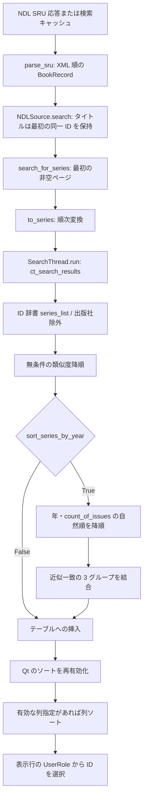

# NDL Search と ComicTagger GUI の検索結果順序：調査・実装仕様

調査日: 2026-10-30（Asia/Tokyo）。状態: **調査完了／実装未着手**。

## 1. Executive Summary

**事実・実測:** JP Talker のタイトル検索は NDL の取得順を保持するが、ComicTagger 1.6.0-beta.9 の `SeriesSelectionWindow.search_complete()` は、①タイトル類似度、②条件付きの年・巻数、③条件付きの候補分類で並べ替える。その後、Qt の有効な列ソートがあれば、それが最終表示順を決める。[ホストの処理][H-series]

重要な発見は次のとおり。

- 類似度ソートは無条件。年順・完全一致優先を両方無効にしても、取得順は一般には保持できない。
- `exact_series_matches_first` は定義・設定画面・保存処理には存在するが、この版の候補分類では参照されない。候補分類は `sort_series_by_year` の条件内にある。
- 初回の Qt テーブルは、今回の環境ではソート列が範囲外の `4`、方向が降順だった。列数は 4（有効列は 0〜3）で、初回には追加ソートを観測しなかった。列見出しをクリックするとソートが働き、同じウィンドウでの再検索にも残る。
- `ComicSeries.start_year` は JP Talker の日付解決結果の年であり、NDL の内部検索インデックス `issued_date` のコピーではない。紙とデジタル版の日付差、月日を落とした同年比較などがある。
- 公開 Talker API に GUI のソートを指定・抑止する手段はない。

**推奨設計:** 方式 C。ホストに、ソースごとに利用者が選ぶ `Host relevance` / `Source order` を追加する。既定は従来の `Host relevance`。JP Talker のメタデータや公開 API は変更しない。技術評価は **CONDITIONAL**、実装開始判断は **HOLD**。対象ホスト版、取り込み・配布方針、列操作の仕様合意が必要である。

## 2. Investigation Scope

対象はローカルのマージ済み JP Talker、インストール済みホスト、その取得元の既存ローカル checkout。ソースを読み、固定 XML と実際の Qt ウィジェットを使って観測した。

Production code、既存テスト、ComicTagger 本体、利用者の設定は変更していない。書籍を開いたりタグを書いたりしていない。依存関係の更新・インストール、実 API 検索、commit・push・tag・Release・PR 作成も行っていない。

区分を以下で統一する。

| 区分 | 意味 |
|---|---|
| 事実 | 指定版のコードから確認できること |
| 実測 | 今回の固定データと実行環境で観測したこと |
| 推論 | 事実から導く説明。外部サービスの実挙動の証明ではない |
| 設計案 | 次工程で実装する候補。現在の機能ではない |
| 未確認 | 今回実行・確認していないこと |

関連資料は [README の検索説明](../README.md#タイトル検索)、[従来の取得順調査](research.md)、[検証履歴](validation_history.md)、[HTTP 診断の境界](ndl_http_diagnostics_i1.md) を参照する。本書は GUI の順序と次工程の設計に限定し、過去の API 調査・日付仕様・補完処理を再定義しない。過去文書の「タイトル順」という記述は履歴であり、現在の `title` は API の既定順を指す。

## 3. Environment and Source Versions

| 対象 | 今回確認した状態 |
|---|---|
| JP Talker ブランチ | `main` |
| HEAD | `d186c8e776a0a7ea6cf70d6da056027cc7fb258d` |
| マージ | `Merge pull request #10 from karigane-cha:fix/ndl-title-search-order` |
| 修正コミット | `33ddb71`、`fix(ndl): preserve API result order for title searches` |
| 開始時の `git status --short` | 出力なし。前の会話時点の未ステージ変更は既にマージ済み |
| 依存指定 | `comictagger>=1.6.0b9,<1.7`、開発用 `comictagger[gui,cix]==1.6.0b9`（[pyproject.toml][JP-project] 13・16 行） |
| 実際に import したホスト | `.venv/Lib/site-packages/comictaggerlib`、distribution `comictagger==1.6.0b9` |
| インストール元 | distribution の `direct_url.json`: `file:///C:/Work/VSCode/comictagger-jp-talker/.research/comictagger` |
| ローカル upstream checkout | `.research/comictagger`、作業ツリーはクリーン |
| upstream commit / tag | `57e5571c91c7515ee2cd594da6c780e61b056b15` / `1.6.0-beta.9` |
| upstream remote | `https://github.com/comictagger/comictagger.git` |
| Python | `.venv/Scripts/python.exe`: CPython 3.12.14、Windows x64 |
| GUI / 自然順ソート | PyQt 6.11.0、Qt 6.11.0、natsort 8.4.0、`QT_QPA_PLATFORM=offscreen` |

インストール済みと checkout の次の 10 ファイルがバイト単位で一致した:
`seriesselectionwindow.py`、`issueselectionwindow.py`、`matchselectionwindow.py`、`ctsettings/file.py`、`settingswindow.py`、両 `seriesselectionwindow.ui` / `settingswindow.ui`、`comictalker/comictalker.py`、`comicapi/genericmetadata.py`、`comicapi/utils.py`。
主対象 `seriesselectionwindow.py` の SHA-256 は `07be4c64449adc61ba13fee6990941100e90811b5b9896a2faeafe82167ecc4f`。

根拠リンクは上記 SHA に固定する。リモートの最新ソースは取得していない。リンク先のパス・行は同一 SHA のローカル checkout と照合した。利用者が別途起動する ComicTagger 実行ファイルの版までは確認していない。

依頼に記載された前工程の Python 3.12 / 3.14 のテスト結果は履歴として扱う。今回の Python 3.14 用既存仮想環境は `C:\Users\mochitama\AppData\Local\Programs\Python\Python314\python.exe` がなく起動できなかった。今回の GUI 実測は Python 3.12 のみである。

## 4. Current NDL Search Order Behavior

[NDL 実装][JP-ndl] の現状は依頼の前提と一致する。

- `build_cql()`（64〜108 行）はタイトル検索の `oldest` に `AND sortBy=issued_date/sort.ascending`、`newest` に `AND sortBy=issued_date/sort.descending` を付ける。`title` は sortBy を付けない。ISBN・`itemno` があればそれらを優先する。
- `parse_sru()`（228〜286 行）は XML の record 要素の順に有効な書誌を追加する。無効な書誌は警告にし、残った書誌をソートしない。
- `NDLSource.search()`（513〜556 行）は ISBN または `itemno` がある場合だけ `rank_records()` を使用する。それ以外では `setdefault(record.id, record)` で最初の同一 ID を残し、挿入順で返す。巻次だけなどの非識別子検索もこの経路。
- `rank_records()`（289〜317 行）の ISBN 一致、NDL 提供機関、情報量、ID の順序と、ランキング後の同一 ID 除去は従来どおり。
- 検索キャッシュは生の SRU 応答。キーは `maximum_records:CQL` の SHA-256。ヒット・再取得の両方が同じ解析・重複除去を通る。キャッシュのデータベース行順は検索候補の順序を決めない。
- レコード単位のキャッシュは検索応答とは別である。同一 ID が応答内で重複すると保存は順次行われるため、後の詳細取得と検索時に残した最初のレコードの内容が異なる可能性はある。今回その挙動は変更しない。
- 取得上限は既定 20、設定範囲 1〜100。`startRecord=1`、1 クエリ 1 リクエスト。上限外の候補は GUI でも表示・ソートできない。`total` は応答の総件数、`truncated` は解析時の判定を維持する。

既存の [取得順・キャッシュ・ランキング テスト][JP-test-ndl]（388〜459 行）と [Talker 経由の順序テスト][JP-test-series]（15〜58 行）がこの境界を扱う。今回これらは変更・再実行していない。

## 5. JP Talker Data Flow

[Talker][JP-talker] の `_query()`（183〜203 行）は ISBN とタイトルを区別し、タイトルなら巻番号・著者・出版社と `search_order` を渡す。`literal=True` は巻番号推定と条件緩和を避けるが、ホストの GUI ソートを無効にする指定ではない。

`_search()`（205〜230 行）は、空の結果のときだけ巻番号・著者を段階的に緩和する。出版社・資料種別は維持する。最初の非空ページを返し、複数の検索結果を併合しない。候補集合は変わり得るが、最終ページ内の順序は維持する。

`search_for_series()`（233〜260 行）は警告を記録し、callback に取得件数と総件数を渡し、リスト内包表記で `to_series(record, ...)` を順に呼ぶ。並べ替えはない。`SearchThread.run()` はこのリストをそのまま `ct_search_results` に格納する。

### ComicSeries のフィールド

[変換処理][JP-map]（425〜537 行）、[BookRecord / SearchPage][JP-models]、[ホストの ComicSeries 定義][H-models]（130〜145 行）に基づく。

| フィールド | JP Talker が渡す値 |
|---|---|
| `id` | NDL の書誌 URL から取り出した `record.id` |
| `name` | `record.title`。シリーズ名への置換やソート用加工なし |
| `aliases` | 空の set |
| `count_of_issues` | 常に 1。NDL の 1 書誌を 1 候補として扱う |
| `count_of_volumes` | `None` |
| `description` | 原タイトル・シリーズ・巻次・日付・提供機関等と警告を HTML エスケープして連結 |
| `image_url` | 空文字列 |
| `publisher` | `record.publishers` を ` / ` で結合、なければ空文字列 |
| `start_year` | `to_metadata()` → `resolve_publication_date()` の年 |
| `format` | 現在の `to_metadata()` では `None` |
| `web_links` | 返却された NDL 書誌 URL、なければ空リスト |

`resolve_publication_date()`（[mapping.py][JP-map] 358〜383 行）は、`bibliographic` では書誌の issued/date、`auto` ではデジタル資料の証拠がある場合に関連 Item や digitized の日付を検討する。競合時・欠落時のフォールバックもある。`available` を出版日にはしない。

**実測:** F のデジタル候補では書誌年 1990 に対し `start_year=2025` になった。**推論:** NDL が用いる内部 `issued_date` と同じ値とは保証できず、GUI の年昇順を NDL の `oldest` の再現として使うことはできない。NDL の内部日付の決定規則自体は今回未確認。

## 6. ComicTagger GUI Sorting Pipeline

以下の番号は段階であり、別の検索リクエストを意味しない。ホストには出版社除外フィルターがあり、これは残りの相対順序を保ったまま候補集合を減らす。



| 段階 | 入力 → 出力・次の処理 | 順序変更 | 基準 / 制御元 | 根拠 |
|---|---|---|---|---|
| 1 | SRU XML → 解析 | API 側で決定 | CQL / NDL | [ndl.py][JP-ndl] 64〜108、333〜343 行 |
| 2 | XML → `SearchPage.records` | なし、有効書誌のみ | XML 要素順 / JP Talker | 同 228〜286 行 |
| 3 | `BookRecord[]` → 重複除去済みページ | タイトルはなし | 最初の ID、識別子検索はランキング / JP Talker | 同 513〜556 行 |
| 4 | 検索条件 → 最初の非空ページ | ページ内はなし | 空結果時の緩和 / JP Talker | [talker.py][JP-talker] 205〜230 行 |
| 5 | 各 `BookRecord` → `ComicSeries[]` | なし | リストの反復 / JP Talker | 同 233〜260 行、[mapping.py][JP-map] 499〜537 行 |
| 6 | 返却リスト → `ct_search_results` | なし | 直接代入 / ホスト | [seriesselectionwindow.py][H-series] 63〜80 行 |
| 7 | リスト → ID 辞書、出版社除外 | 相対順は保持 | 初出 ID の位置 / ホスト | 同 591〜607 行 |
| 8 | ID 辞書 → 類似度降順辞書 | あり | SequenceMatcher / ホスト | 同 609〜617 行 |
| 9 | 辞書 → 年・巻数降順辞書 | 条件付き | natsort、年設定 / ホスト | 同 623〜633 行 |
| 10 | 辞書 → グループ結合辞書 | 条件付き | 2 種の ratio > 0.9 / ホスト | 同 635〜660 行 |
| 11 | 辞書 → テーブル行 | 挿入中はなし | sorting 無効 / ホスト | 同 664〜673 行 |
| 12 | テーブル → 表示行 | 条件付き | 現在の列・方向 / Qt | 同 675〜676 行、9 節の実測 |

ホストの ID 辞書生成では同一 ID の値は最後の候補で上書きされ、位置は最初の挿入位置になる。ただし今回の JP Talker の返却リストは同一 ID を除去済みである。

## 7. Sorting Configuration Analysis

### 類似度計算

[utils.sanitize_title()][H-utils]（462〜516 行）は NFKD と casefold、引用符除去を行う。`basic=False` ではさらに文字種を絞り、句読点をハイフンに置換し、冠詞除去等を行う。`basic=True` はその追加処理を行わない。日本語タイトルの巻番号や副題が常に除かれる処理ではない。

ホストの変数名と初期化には注意が必要である。実コードは次の組み合わせを使う。

| 用途 | 検索語側 | 候補側 |
|---|---|---|
| `score()` と `ratio_full` | `sanitize_title(query, True)` | `sanitize_title(name, False)` |
| `ratio_basic` | `sanitize_title(query, False)` | `sanitize_title(name, True)` |

`SequenceMatcher(None, a)` に候補を `set_seq2()` し、`ratio()` を求める。引数の向き・basic の値を名称から推測して逆にしないこと。[seriesselectionwindow.py][H-series] 609〜650 行。

`sorted(..., reverse=True)` は設定によらず実行される。同スコアは安定ソートにより入力順を保つ。取得順を保てるのは、他のソートが無効・不作用であり、スコア順が既に入力順と一致する場合などに限られる。「全タイトルが同じ」はその十分条件の一例であって、設定による保証ではない。

### 設定の定義・保存・GUI

| 項目 | `sort_series_by_year` | `exact_series_matches_first` |
|---|---|---|
| 既定値 | `True` | `True` |
| CLI | `--sort-series-by-year` / `--no-sort-series-by-year` | `--exact-series-matches-first` / `--no-exact-series-matches-first` |
| 定義 | [ctsettings/file.py][H-settings-def] 67〜72 行 | 同 73〜78 行 |
| 設定ファイル | `settings.json` の `Issue Identifier` グループ | 同左 |
| GUI | Preferences → Searching → `cbxSortByYear` | 同 → `cbxExactMatches` |
| 読み込み・保存 | [settingswindow.py][H-settings] 475〜476、609〜610、654 行 | 同左 |
| 実際の候補ソートへの作用 | 年順＋候補分類を一括制御 | この版では参照されず、切り替えても作用しない |

`argparse.BooleanOptionalAction` が否定形を提供する。GUI のラベルは [settingswindow.ui][H-settings-ui] 332〜343 行を参照。年順設定のラベルには “instead of No. Issues” とあるが、年順無効時のコードは単純な巻数順ではなく、無条件の類似度順である。

保存先は `Runtime_Options__config.user_config_dir / "settings.json"`。[main.py][H-main] 237〜246 行、[ctsettings/types.py][H-paths] 21〜62 行、[ctsettings/__init__.py][H-config] 97〜126 行。今回の環境で既定パスを算出すると `C:\Users\mochitama\AppData\Local\ComicTagger\ComicTagger\settings.json`。`--config` で変わるため全環境の固定パスではない。既存の実設定ファイルは開いても書いてもいない。GUI の保存経路は確認したが、実利用者設定の永続化操作は未実施。

### 年順と候補分類の優先順位

年順が有効なら、類似度順の後に `(str(start_year), str(count_of_issues))` をキーとする `natsort.natsorted(..., reverse=True)` が動く。新しい年が先、同年なら巻数の多い候補が先。同じキーでは直前の類似度順を保つ。JP Talker は巻数がすべて 1 なので、その第 2 キーは通常差を作らない。

`None` は数値の欠落として別処理されず文字列 `"None"` になる。今回の natsort では `None` 年が数値年より先になった。別の Qt 列ソートでは年セルは空文字列なので、同じ欠落値でも別の比較になる。

その後、以下のグループへ順に追加し、0 → 1 → 2 と連結する。

| グループ | 判定 |
|---|---|
| 0 | `ratio_basic > 0.9` |
| 1 | 0 に入らず `ratio_full > 0.9` |
| 2 | 上記以外 |

「完全一致」という設定名でも、文字列完全一致ではない。`Joker` に対する `Jokers` の ratio は 0.90909… でグループ 0 に入る。しきい値は固定の **厳密な > 0.9**。検索に渡す `series_match_thresh=90` とは別の処理である。

各グループ内では年順の結果が保持される。したがって Qt 列ソートがない場合の優先順位は、年設定有効時には **グループ → 年 → 巻数 → 類似度 → 元の取得順**、無効時には **類似度 → 元の取得順**。実測は 9 節。

## 8. Qt Table Sorting Behavior

[seriesselectionwindow.py][H-series] 664〜676 行は、sorting 無効 → 全行削除 → `series_list.values()` 順に挿入 → sorting 有効 → 先頭行選択、の順である。`SeriesSelectionWindow` 自体には `sortItems()` の明示呼び出しがない。[seriesselectionwindow.ui][H-series-ui] は列 4 個を定義し、有効な初期ソート列・方向を指定していない。

**実測:** 初期状態は `(sortIndicatorSection=4, DescendingOrder, sortingEnabled=False)`。有効列 0〜3 の外なので、`setSortingEnabled(True)` の直後もホストの挿入順が残った。これは Qt 6.11.0 とこの UI ファイルでの結果であり、他版で保証された既定値として実装に利用してはいけない。

Year 列をクリックすると `(1, AscendingOrder)` になり、`G-old → G-mid → G-new` へ変化した。同じ画面で再検索すると、挿入中は sorting が無効でも、再有効化時に同じ列順が再適用された。新しく作ったダイアログにはこのクリック状態を引き継ぐ保存処理は確認できない。`internal.sort_column / sort_direction` は別のファイル一覧が利用する設定であり、この候補テーブルの永続設定と混同しない。

### 選択 ID と詳細取得

- 列 0 の `Qt.ItemDataRole.UserRole` に真の `series.id` を保持する（348〜350 行）。
- `_fetch(row)` はその ID を取り出し、`series_list[id]` を参照する（389〜401 行）。辞書の n 番目とテーブルの n 行目を対応させていない。
- `select_by_id()` は表示中の各行の UserRole を照合する（545〜549 行）。
- `show_issues()` は選択 ID を issue selector に渡す（525〜533 行）。issue 側は独自に issue 番号をソートし、UserRole から issue ID を取得する。[issueselectionwindow.py][H-issues] 118〜144、178 行以降。
- Auto-Select は先頭候補を自動採用する処理ではなく、`IssueIdentifier` による照合へ進む（[seriesselectionwindow.py][H-series] 442〜512 行）。`matchselectionwindow.py` のソートは別画面である。

**実測:** 96 通りの全表示行、Year 列ソート後、再検索後、`select_by_id()` の選択で ID が一致した。選択した実書籍への書き込みはしていない。

**別の境界リスクを実測:** sorting 有効のまま `update_row()` が現在のソートキーを変更すると、その行が途中で移動し、その後のセル更新が元の行番号に対して続く。固定データで年昇順の先頭 `G-old` を 1980 → 2030、publisher を `CHANGED` にしたところ、年セルと ID は末尾へ移動したが publisher は `G-mid` 行へ書かれた。これは signal を一時遮断して実メソッドを直接呼ぶ分離実験で、通常選択の誤 ID を再現したものではない。しかし詳細取得で値が変わる条件では行表示の整合性にリスクがある。次工程で行更新の原子性と選択 ID を合わせて検証する。既存実装は今回修正しない。

## 9. Reproduction and Evidence

### 実行方法・境界

Python のコードを PowerShell の here-string から `.venv/Scripts/python.exe -B -` の標準入力へ渡した。スクリプト ファイルは作成していない。`PYTHONDONTWRITEBYTECODE=1`、`PYTHONUTF8=1`、`QT_QPA_PLATFORM=offscreen` を使用。

既存 `tests/conftest.py` の `ordered_search_xml` を雛形に固定 XML を構成し、`NDLSource._request` の戻り値だけを Mock で置換した。実際の解析・キャッシュ・Talker 変換・SearchThread・search_complete・QTableWidget を実行した。ソート関数を差し替えていない。`sys.settrace` で処理段階の辞書順を観測した。HTTP はテスト内で禁止し、画像 URL も空だった。

一時設定・キャッシュはリポジトリ外の `TemporaryDirectory` のみ。初回は Qt 画像キャッシュの SQLite 接続が残って削除に失敗したため、プロセス終了後にその専用ディレクトリを削除した。再実行では専用一時領域の接続だけを閉じ、`TEMP_REMOVED True` を確認した。利用者設定・本体ソースへの変更はない。

### 固定データと観測結果

検索語は `漫画`。表の値は実際の固定 NDL ID。特記しないタイトルは `漫画`。年は `start_year`。

| ケース | API / Talker の入力順と条件 | 年設定 False の内部・表示順 | 年設定 True の内部・表示順 |
|---|---|---|---|
| A: 同題・異年 | A-old:1990 → A-new:2020 → A-mid:2000 | A-old → A-new → A-mid | A-new → A-mid → A-old |
| B: 同年・類似度差 | B-low:別作品 → B-exact:漫画 → B-mid:漫画 1、すべて 2000 | B-exact → B-mid → B-low | 同左 |
| C: 同題・同年 | C-z → C-a、2000 | C-z → C-a | 同左。ID 辞書順にはしない |
| D: 巻次・副題 | D-v2:漫画 2 → D-sub:漫画 : 外伝 → D-v1:漫画 1 → D-exact:漫画、2000 | D-exact → D-v2 → D-v1 → D-sub | 同左 |
| E: 年欠落 | E-known:2000 → E-none:None | E-known → E-none | E-none → E-known |
| F: 紙とデジタル | F-paper:2020 → F-digital:書誌 1990・digitized 2025 | F-paper → F-digital | F-digital → F-paper |
| G: 取得順と年順の相違 | G-new:2020 → G-old:1980 → G-mid:2000 | G-new → G-old → G-mid | G-new → G-mid → G-old |
| H: 上限超過 | 総数 40、上限 20、固定応答 2 件 H-old:1980 → H-new:2020 | H-old → H-new | H-new → H-old |

8 ケース × 年設定 2 × 完全一致設定 2 × 取得モード 3 = **96 通り成功**。全通りで `parse_sru` の ID 順と `SearchThread.ct_search_results` の ID 順は一致。完全一致設定の切り替えで内部順・表示順が変わらないことも assert した。

**検証上の制限:** 各モードに同じ固定応答を与えてホスト側の影響だけを分離した。NDL サーバーが各モードで同じ応答を返すと主張するものではない。取得モードの CQL とキャッシュ分離は既存テストを根拠とする。H は上限外を取得して並べ替える機能がないことの例であり、40 件の実データを検索していない。

### 処理段階の比較

B / 年 False:
`[B-low,B-exact,B-mid]`（API、Talker、ID 辞書）
→ `[B-exact,B-mid,B-low]`（類似度）
→ 同順（挿入、Qt 再有効化、表示）。

A / 年 True:
`[A-old,A-new,A-mid]`（API、類似度）
→ `[A-new,A-mid,A-old]`（年）
→ 同順（分類、挿入、Qt、表示）。

追加の分類実験は検索語 `Joker`、12 通りで成功した。

| ID | タイトル | 年 | score / ratio_full | ratio_basic | グループ |
|---|---|---:|---:|---:|---:|
| J-far | Other | 2025 | 0.6 | 0.6 | 2 |
| J-article | The Joker | 2020 | 1.0 | 0.714286 | 1 |
| J-near | Jokers | 2010 | 0.909091 | 0.909091 | 0 |
| J-exact | Joker | 1980 | 1.0 | 1.0 | 0 |

入力は表の順。類似度後は `J-article,J-exact,J-near,J-far`。年設定 True では年順が一旦 `J-far,J-article,J-near,J-exact` になり、分類後は `J-near,J-exact,J-article,J-far` になった。`exact_series_matches_first=False` でも同じ。完全一致文字列より新しい近似一致が先になり得る。

同年の巻数の補助実測は `[(n1,2000,1),(n10,2000,10),(n2,2000,2),(tie,2000,2),(unknown,None,1)]` に実コードと同じ natsort キーを適用し、`unknown,n10,n2,tie,n1`。同じ年・巻数の n2 / tie の相対順は維持された。

### 再実行用コード

以下は成功した主実験のコードそのもの。リポジトリのルートで、次の形式の `<code>` を下の Python ブロックに置換して実行できる。全テスト スイートの実行コマンドではない。

```powershell
$env:PYTHONDONTWRITEBYTECODE='1'
$env:PYTHONUTF8='1'
$env:QT_QPA_PLATFORM='offscreen'
@'
<code>
'@ | .venv/Scripts/python.exe -B -
```

<details>
<summary>96 通りの実測コード（固定 XML・一時領域・実 Qt）</summary>

```python
import contextlib,copy,gc,hashlib,importlib.metadata as md,json,logging,os,runpy,sqlite3,sys,tempfile
from pathlib import Path
from unittest.mock import Mock,patch
import requests
from PyQt6 import QtCore,QtWidgets,QtTest
from comictaggerlib.ctsettings import ComicTaggerPaths
from comictaggerlib.main import App
from comictaggerlib.seriesselectionwindow import SearchThread,SeriesSelectionWindow
from comictagger_jp_talker.talker import JapaneseBooksTalker
from comictagger_jp_talker.sources.ndl import NDLSource,NS,parse_sru
import xml.etree.ElementTree as ET
logging.disable(logging.CRITICAL)
app=QtWidgets.QApplication.instance() or QtWidgets.QApplication([])
QtCore.qInstallMessageHandler(lambda *args: None)
template=runpy.run_path("tests/conftest.py")["ordered_search_xml"].__wrapped__()
base=ET.fromstring(template)
sample=copy.deepcopy(base.find("sru:records/sru:record",NS))
cases={
"A":[("A-old","漫画","1990",None),("A-new","漫画","2020",None),("A-mid","漫画","2000",None)],
"B":[("B-low","別作品","2000",None),("B-exact","漫画","2000",None),("B-mid","漫画 1","2000",None)],
"C":[("C-z","漫画","2000",None),("C-a","漫画","2000",None)],
"D":[("D-v2","漫画 2","2000",None),("D-sub","漫画 : 外伝","2000",None),("D-v1","漫画 1","2000",None),("D-exact","漫画","2000",None)],
"E":[("E-known","漫画","2000",None),("E-none","漫画",None,None)],
"F":[("F-paper","漫画","2020",None),("F-digital","漫画","1990","2025")],
"G":[("G-new","漫画","2020",None),("G-old","漫画","1980",None),("G-mid","漫画","2000",None)],
"H":[("H-old","漫画","1980",None),("H-new","漫画","2020",None)]
}
def payload(rows,total=None):
    root=copy.deepcopy(base)
    root.find("sru:numberOfRecords",NS).text=str(total or len(rows))
    records=root.find("sru:records",NS)
    records[:]=[]
    for rid,title,year,digital in rows:
        node=copy.deepcopy(sample)
        for elem in node.iter():
            if "{"+NS["rdf"]+"}about" in elem.attrib:
                elem.set("{"+NS["rdf"]+"}about","https://ndlsearch.ndl.go.jp/books/"+rid)
        bib=node.find("sru:recordData/rdf:RDF/dcndl:BibResource",NS)
        bib.find("dcterms:title",NS).text=title
        issued=bib.find("dcterms:issued",NS)
        if year: issued.text=year
        else: bib.remove(issued)
        if digital: ET.SubElement(bib,"{"+NS["dcndl"]+"}dateDigitized").text=digital
        records.append(node)
    return ET.tostring(root)
def ids(w):
    return [w.twList.item(r,0).data(QtCore.Qt.ItemDataRole.UserRole) for r in range(w.twList.rowCount())]
def forbidden(*a,**k): raise AssertionError("network forbidden")
report=[]
with tempfile.TemporaryDirectory(prefix="ndl-gui-investigation-") as temp, patch.object(requests.sessions.Session,"request",forbidden):
    root=Path(temp).resolve()
    assert root.parent == Path(tempfile.gettempdir()).resolve()
    talker=JapaneseBooksTalker("1.6.0b9",root)
    host=App(); host.talkers={"jpbooks":talker}
    paths=ComicTaggerPaths(root/"config")
    host.initialize_dirs(paths); host.register_settings(False)
    config=host.parse_settings(paths,"--config",str(paths.path))[0]
    config.Auto_Tag__use_publisher_filter=False
    parent=QtWidgets.QWidget()
    source=NDLSource(root/"source")
    talker._source=source
    source._request=Mock()
    for case,rows in cases.items():
        for mode in ("oldest","newest","title"):
            talker.search_order=mode
            source._request.return_value=payload(rows,40 if case=="H" else None)
            for byyear,exact in ((False,False),(False,True),(True,False),(True,True)):
                config.Issue_Identifier__sort_series_by_year=byyear
                config.Issue_Identifier__exact_series_matches_first=exact
                w=SeriesSelectionWindow(parent,config,talker,series_name="漫画")
                header=w.twList.horizontalHeader()
                initial=(header.sortIndicatorSection(),header.sortIndicatorOrder().name,w.twList.isSortingEnabled())
                thread=SearchThread(talker,"漫画",True,False,90); thread.run()
                assert not thread.ct_error
                api=[r.id for r in parse_sru(source._request.return_value).records]
                returned=[r.id for r in thread.ct_search_results]
                assert api==returned
                w.search_thread=thread
                stages={}
                def trace(frame,event,arg):
                    if event=="line" and frame.f_code is SeriesSelectionWindow.search_complete.__code__:
                        line=frame.f_lineno
                        if line in (594,623,635,662,675,676):
                            stages[str(line)]=list(w.series_list)
                        if line==676: stages["qt_after_enable"]=ids(w)
                    return trace
                sys.settrace(trace)
                try: w.search_complete()
                finally: sys.settrace(None)
                final=ids(w)
                # Every displayed ID resolves through the real row selection handler.
                for rid in list(final):
                    row=ids(w).index(rid)
                    w.twList.selectRow(row)
                    assert w.series_id==rid
                    assert w._fetch(ids(w).index(rid)).id==rid
                report.append(dict(case=case,mode=mode,byyear=byyear,exact=exact,api=api,returned=returned,years=[r.start_year for r in thread.ct_search_results],initial=initial,stages=stages,internal=list(w.series_list),final=final))
                w.selector.hide(); w.hide(); w.deleteLater(); app.processEvents()
    # A real header click, followed by another search on the same window.
    source._request.return_value=payload(cases["G"])
    config.Issue_Identifier__sort_series_by_year=False
    w=SeriesSelectionWindow(parent,config,talker,series_name="漫画")
    thread=SearchThread(talker,"漫画",True); thread.run(); w.search_thread=thread; w.search_complete()
    header=w.twList.horizontalHeader()
    pos=QtCore.QPoint(header.sectionViewportPosition(1)+header.sectionSize(1)//2,header.height()//2)
    QtTest.QTest.mouseClick(header.viewport(),QtCore.Qt.MouseButton.LeftButton,pos=pos)
    clicked=ids(w); indicator=(header.sortIndicatorSection(),header.sortIndicatorOrder().name)
    thread=SearchThread(talker,"漫画",True); thread.run(); w.search_thread=thread; w.search_complete()
    repeated=ids(w)
    assert clicked==repeated
    for rid in repeated:
        w.twList.selectRow(ids(w).index(rid)); assert w.series_id==rid
    w.series_id="G-old"; w.select_by_id(); assert w.twList.item(w.twList.currentRow(),0).data(QtCore.Qt.ItemDataRole.UserRole)=="G-old"
    print("HEADER",json.dumps(dict(clicked=clicked,indicator=indicator,repeated=repeated,select_by_id=w.series_id)))
    w.selector.hide(); w.hide(); w.deleteLater(); parent.deleteLater(); app.processEvents()
    source.cache.close(); source.session.close()
    app.sendPostedEvents(None,QtCore.QEvent.Type.DeferredDelete)
    gc.collect()
    for obj in gc.get_objects():
        if isinstance(obj,sqlite3.Connection):
            try:
                files=[Path(row[2]).resolve() for row in obj.execute("PRAGMA database_list") if row[2]]
                if files and all(p.is_relative_to(root) for p in files): obj.close()
            except sqlite3.ProgrammingError: pass
# All 96 results must be invariant when toggling the unused exact setting or API request mode.
for case in cases:
    for byyear in (False,True):
        group=[r for r in report if r["case"]==case and r["byyear"]==byyear]
        assert all(r["final"]==group[0]["final"] and r["internal"]==group[0]["internal"] for r in group)
print("RUNS",len(report),"TEMP_REMOVED",not root.exists())
for r in report:
    if r["mode"]=="oldest" and not r["exact"]: print(json.dumps(r,ensure_ascii=False))

```

</details>

主実験は終了コード 0、`RUNS 96 TEMP_REMOVED True`。追加分類実験は上記のケース定義を J に置換し、検索語を `Joker` にして同じ 12 組を実行した。終了コード 0、`RUNS 12 TEMP_REMOVED True`。

行更新の追加実験は、G の表示で次を実行した（ウィジェットは一時領域の検証用インスタンスのみ）。

```python
from dataclasses import replace
w.twList.blockSignals(True)  # update_row 自体を分離して観測するため
w.twList.sortItems(1, QtCore.Qt.SortOrder.AscendingOrder)
w.update_row(0, replace(w.series_list["G-old"], start_year=2030, publisher="CHANGED"))
```

結果は `[(G-mid,2000,CHANGED),(G-new,2020,""),(G-old,2030,"")]`。signal 遮断による分離実験と通常の選択イベント経路を区別すること。

今回全 pytest スイートは再実行していない。調査コードは上記と補助的なバージョン・natsort・ハッシュ確認のみ。既存テストの成功件数を今回の結果として転記しない。

## 10. Root Cause Analysis

原因は 1 つのソートではなく、責務の異なる処理が直列に適用されることにある。

1. JP Talker の取得順設定は、API から取得する有限の候補集合と、その返却順を指定する。
2. ホストはその順序を「利用者が指定した表示順」とは扱わず、候補を類似度で再評価する。
3. 年設定が有効なら、年・巻数のソートと近似一致グループによって順序を上書きする。年が欠落した候補やデジタル版の日付も、この基準に従う。
4. 利用者が列ソートを指定していれば、Qt がさらにその基準で行を配置する。

取得順が残るのは各段階で順序が偶然変わらない条件に限られる。年設定 False は、①無条件の類似度ソートも、②既に有効な Qt 列ソートも解除しない。完全一致設定 False は beta.9 の実装では候補分類を止めない。

今回の NDL 順序維持修正は正常に働いており、GUI 側の問題を再び NDL のランキングや日付変換で補正する設計は採らない。

## 11. Implementation Options A–D

判定は「標準ワークフローで取得順を確実に表示する」という目的に対する評価。単に画面を作れるかとは区別する。

| 観点 | A: 既存設定 | B: 現行公開 Talker API | C: ホストに正式な表示モード | D: 専用 GUI |
|---|---|---|---|---|
| 総合判定 | **NOT_FEASIBLE**（近づける調整自体は可能） | **NOT_FEASIBLE** | **CONDITIONAL** | **UNVERIFIED** |
| 正確な取得順 | 類似度と列ソートが残り不可 | ソート抑止 API がなく不可 | 各ホストソートと Qt の適用を制御すれば可能 | 自画面内なら設計可能、標準フロー統合は未確認 |
| oldest / newest / title | 完全な区別を保持できない | 入力順を返せるが表示を保証できない | 3 モードすべて返却順として尊重 | 自画面は可能でも API と選択連携が課題 |
| JP Talker 単独 | 利用者操作で調整のみ | 現行 API では不可 | 不可、ホストの実装が必要 | 外部アプリ化は可能性あり、標準 Talker 単独の画面差し替えは不可 |
| ホスト変更 | 不要 | API が増えない限り不可 | 必要 | 外部ツールなら不要、標準フロー統合には必要になり得る |
| 公開 API の範囲 | 既存設定の範囲 | `ComicSeries` に順位フィールドなし | Talker 側は既存リスト API のまま | UI 登録・選択返却 API が見当たらない |
| 他 Talker | 共通設定のため影響する | 補正のための偽装は許容しない | ソース別 opt-in と既定維持で抑制 | 内部 GUI 接続に依存すると広範な影響 |
| 既存検索・選択へのリスク | 関連候補の優先度が変わる | 達成には禁止された内部依存が必要 | モード切替・列操作・選択の回帰確認が必要 | 非同期処理・選択受け渡し・自動タグ付けが複雑 |
| beta.9 互換性 | 設定は使えるが目的未達 | 目的未達 | 未改修 beta.9 では使えない | 標準統合は未確認 |
| 将来版への耐性 | 設定の実装差に依存 | API 拡張待ち | upstream 合意・テストがあれば最も保守しやすい | 内部実装依存が大きい |
| 複雑さ / テスト | 小 / ただし保証不可 | 小さな変更では解けない | 中 / ホスト側の固定データ・Qt テストが可能 | 大 / 画面とワークフロー全体の検証が必要 |
| 保守負担 | 小、制約説明が必要 | 安全な現行実装案なし | upstream 採用まではパッチ版管理・配布が必要 | 高い |

### B を採用できない根拠

[ComicTalker.search_for_series()][H-api]（172〜199 行）は `list[ComicSeries]` を返す。callback は進捗通知、`literal` と `series_match_thresh` はホストから Talker への検索条件。順位指定の戻り値・GUI 登録フックはない。

[ComicSeries][H-models] には順位・sort policy がなく、任意の追加属性を付けてもホストは読まない。返却リスト順はすでに守られているが、その後のホスト処理が上書きする。[標準 ComicVine Talker][H-cv]（271〜360 行）も同じ公開契約を使い、独自 GUI の呼び出しやソートを無効にする戻り値はない。

### D の境界

`SearchThread.run()` はワーカー内で Talker を呼び、結果リストを標準ウィンドウへ返す。そこでプラグインが独自の対話を始めると、Qt のスレッド制約、キャンセル、進捗、他の CLI / 自動タグ付け呼び出しとの整合性が必要になる。

外部の候補選択アプリを作ること自体と、その選択を ComicTagger の `show_issues()` / `issue_selected()` に安全に戻せることは別である。後者を保証する公開 UI API は確認できず、標準ワークフローの代替として推奨しない。画像照合結果の `MatchSelectionWindow` もシリーズ検索画面を置き換える拡張点ではない。

## 12. Compatibility and Risk Assessment

| 対象 | 推奨設計の扱いとリスク |
|---|---|
| 既存 JP Talker ユーザー | 無設定なら従来表示。Source order は明示選択。旧ホストは従来表示のまま |
| タイトル検索 | API の取得順・重複除去・上限・緩和を変更しない |
| ISBN / itemno | Source order は「Talker の返却順」なので既存ランキングを表示する。ISBN を生の SRU 順に戻さない |
| キャッシュ | キー・TTL・保存形式に変更不要。表示モード切替に検索リクエストを発生させない |
| 他 Talker | `talker.id` ごとの設定、空の既定値。JP Talker の選択を他ソースへ波及させない |
| ホストの出版社除外 | 引き続き適用。Source order の保証は除外後に残る候補の相対順 |
| テキスト絞り込み | 行を隠す現在の挙動を維持。隠れた行を含む ID 順を壊さない |
| 自動タグ付け | 検索ウィンドウの表示モードを `IssueIdentifier` に渡さない。画像照合・自動採用条件は変更しない |
| 初期選択 | Source order では返却順先頭が選択される。自動書き込みや自動採用を意味しない |
| 詳細更新 | sorting 中の行移動問題を回帰テストに含める。新モードの実装と別コミットで修正を提案できる |
| 未改修 beta.9 | 新しい表示モードは存在しない。プラグインだけの更新で実現したと告知しない |
| 配布 | ホスト側の取り込みが必要。upstream 未採用なら明示的な対応版の保守が必要 |

[IssueIdentifier][H-identifier] は 599 行で独立して Talker を呼び、676・702 行で画像照合距離をソートする。本提案が扱う表示順とは別。そこへ Source order を流用しない。

年やタイトル・ID の偽装、GUI 内部オブジェクトの無条件書き換え、ソート関数の恒久的な monkey patch、他ソースの設定強制変更、並べ替え目的の追加 API 検索は正式案から除外する。9 節の Mock・trace は一時的な検証手段であり、製品への導入案ではない。

## 13. Recommended Architecture

**方式 C を条件付きで推奨する。**

本体変更なし・公開 API のみを先に評価したが、A と B は目的を満たさない。D は統合 API と保守性の面で C より不確実である。したがってホスト自身が表示順を選択する正式な機能を追加し、プラグイン側の内部依存を避ける。

最小案は次の 2 モードとする。

| モード | 意味 |
|---|---|
| Host relevance | 現在のホストランキング。既定値 |
| Source order | Talker が返したリストの順序。出版社除外後も相対順を保持 |

`Publication ascending` / `Publication descending` は将来候補にとどめ、初期実装に含めない。追加する場合も `start_year` 基準であること、欠落年の位置、同年の安定性を明示し、NDL の `oldest/newest` と同じとは呼ばない。

表示モードはホストに保持する。Talker は検索条件・取得順・正しいメタデータを担当する。ホストが JP Talker の設定名や検索文字列を解析して自動的にモードを変える必要はない。

## 14. Proposed Implementation Specification

以下は未実装の仕様案である。

### A. 機能仕様

1. `SeriesSelectionWindow` に表示順の選択欄を追加する。選択対象は現在の `talker.id`。
2. 初期モードは保存済みのソース別値、未設定・無効値なら `host_relevance`。
3. `source_order` では類似度・年・候補分類をすべて迂回し、元の返却リストを基準にする。既存の年・完全一致設定の値そのものは変更しない。
4. `Title search order` は取得条件のまま。表示モード切替は現在の候補集合に対して行い、再検索しない。新たな API 順を要求するには従来どおり検索をやり直す。
5. 利用者が列見出しをクリックした場合は、明示的な「列順」の一時表示状態へ切り替える。Source order の表示ラベルのまま列順にしてはならない。
6. 「Source order に戻す」で現在の検索応答の元順を復元する。年や ID で推定し直さない。
7. 再検索時、保存モードが Source order なら列順の一時状態を解除して新しい応答の返却順へ戻す。Host relevance なら既存動作との互換性のため列状態を保持する。この違いを UI 説明・テストに明示する。
8. 新ホスト未導入の場合は取得順表示を保証しない。JP Talker が内部 GUI に介入してフォールバックしない。対応版・制限を README に記載する。
9. Source order の説明は「取得した候補の返却順」。未取得の全件を対象とする並び替えとは表示しない。

優先順位は **明示的な列操作（その表示中） > 選択した表示モード > そのモードが利用する既存のランキング設定**。Source order では既存ランキング設定は不使用、Host relevance では互換維持。

### B. 設計仕様

提案する保存キーは `Issue Identifier.series_search_order_by_source`。型は `dict[str, str]`、既定 `{}`、値は `host_relevance` / `source_order` の allowlist。例:

```json
{
  "Issue Identifier": {
    "series_search_order_by_source": {
      "jpbooks": "source_order"
    }
  }
}
```

このキーは現在存在しない。設定の読み込み・保存はホストの settngs と既存 `settings.json` 経路を利用する。保存時は現在のソースの値だけを更新し、他の設定を上書きしない。未知のソース ID の項目は消さず、未知の値のみ安全に host_relevance と解釈する。旧版での未知キーの保持・再保存挙動は次工程の互換性テストが必要。

| 変更対象（ホスト側） | 次工程の変更 |
|---|---|
| `comictaggerlib/seriesselectionwindow.py` / `SeriesSelectionWindow.__init__` | モード選択と列クリックの状態管理を接続 |
| 同 / `search_complete()` | 返却順の独立スナップショットを保持し、フィルター後にモード別の並べ替えを適用 |
| 同 / `update_row()`、`current_item_changed()` | active sort 中の行移動を考慮した更新・ID 再選択を検証。修正が必要なら小さな独立変更 |
| `comictaggerlib/ui/seriesselectionwindow.ui` | 表示モード選択と列順から戻る操作を追加 |
| `comictaggerlib/ctsettings/file.py` / `identifier()` | ソース別の設定定義・入力検証 |
| `comictaggerlib/ctsettings/settngs_namespace.py` | 既存の生成手順で型を同期。生成手順自体は I1 で確認 |
| ホストの設定保存呼び出し元 | 正規の保存経路で選択を永続化。設定画面と競合しないことを確認 |
| ホストのテスト・文書 | 固定順序、設定、Qt、他ソースへの影響のテストと利用者向け説明 |

JP Talker の本番コード、`ComicTalker.search_for_series()` のシグネチャ、`ComicSeries` のフィールドは変更しない。新しい順序属性をメタデータへ埋め込む必要もない。

変更前:
`returned list → ID map/filter → relevance → year/group → rows → Qt column`

変更後:
`returned list → retained source snapshot → stable filter → [legacy host ordering | source ordering] → controlled table state`

スナップショットは元の ID 順を別のリストとして保持する。`series_list` は ID で引ける情報として維持し、詳細取得で内容を更新しても source rank は変更しない。ID 重複時のホスト側の値選択は既存契約を維持し、今回の JP Talker の「最初のレコードを残す」処理を置き換えない。

Source order の描画中・描画後は Qt の自動 sorting を無効にし、初期 indicator の範囲外値に依存しない。列クリックは専用ハンドラーが明示的な列順状態へ遷移させ、そのときだけ既存列ソートを有効にする。Source order 復元時は sorting を無効にしてスナップショット順で再描画する。

再描画前に選択 ID を保持し、再描画後に `UserRole` で復元する。選択 ID がフィルターや新応答で消えた場合は先頭の表示可能候補、空なら未選択。位置番号を永続的な識別子にしない。

sorting 中の詳細更新は、対象の ID を保持して sorting / selection signal を必要な間だけ抑制し、同一行の全セルを更新してから元のソート状態を戻し、ID で選択を復元する案を検証する。例外時も状態を戻す。この課題を新モードと無関係な大規模リファクタリングに広げない。

### C. 互換性・仕様変更の分離

- Host relevance のランキング結果は beta.9 と一致させる。未使用の `exact_series_matches_first` を有効化する修正は、今回のモード追加に紛れ込ませず別の不具合修正として扱う。
- 取得順を選んだソース以外は現状を維持する。
- ISBN 検索でも Source order は有効だが、意味は「既存の ISBN ランキングの返却順」。タイトル用 NDL 順と混同しない。
- `itemno` の取得・エラー、書誌選択後の ID 引き渡し、キャッシュの更新を変更しない。
- `IdentifyThread`、`IssueIdentifier`、CLI、自動タグ付けの入力・判定順には新設定を適用しない。
- 未改修 beta.9 へのプラグイン互換性は維持するが、新機能の利用には対応ホストが必要。

## 15. Regression Test Plan

実装工程ではホスト側にテストを追加する。既存 JP Talker のテスト設定・xfail・ネットワーク除外条件を維持する。

| 層 | 固定データと合格条件 |
|---|---|
| 単体・Host relevance | A〜H と J、各設定で beta.9 の既存結果に一致 |
| 単体・Source order | スコア・年・巻数・ID が逆順でも、返却 ID 順をそのまま保持 |
| 日付境界 | `None`、同年・異日、紙／デジタル日付、異なる巻数。Source order が値に依存しない |
| 検索モード | oldest / newest / title に異なる固定応答の順を与え、それぞれ独立に維持。サーバーのソートをテスト内で代行しない |
| 統合 | 実 NDLSource → Talker → SearchThread → ホスト → Qt の ID 順を段階ごとに比較 |
| キャッシュ | miss / hit / refresh / 再起動で同じ保証。モード切替ではリクエスト数が増えない |
| 候補集合 | 重複 ID、異なる ID の同一 ISBN、空結果、警告、総数超過、条件緩和、出版社除外 |
| Qt 初期表示 | indicator が未指定・有効列・範囲外の各状態でも Source order は取得順 |
| Qt 操作 | 全 4 列の昇順・降順、同値の候補、列順の明示表示、取得順への復元 |
| 再検索・設定 | refresh とフィルター変更で規定の順序状態へ戻る。新規画面・再起動でソース別設定を再現 |
| 選択 | 初期・ソート後・非先頭・隠れた行・選択 ID 消失・`select_by_id` で正しい ID |
| 詳細取得 | タイトル・年・出版社が変わって行移動するケースで全セルと UserRole が一致。現在の行更新問題を検出 |
| issue への連携 | `show_issues` → issue selector → `fetch_comic_data` まで選択した ID と一致。実書籍には書かない |
| 他 Talker | 複数ソースを切り替え、jpbooks の設定が他ソースへ適用されない |
| 自動タグ付け | 新しい表示設定を変えても既存の照合結果・自動採用条件が変わらない |
| 後方互換 | 旧設定、未知の値、欠けたマップ、旧版での設定再保存。安全な既定動作 |
| 実行環境 | Python 3.12 / 3.14、対象ホストの Qt / PyQt 版、offscreen と実ウィンドウ |
| バージョン | beta.9 の基準結果、変更を取り込む対象版、対応範囲の上限版を明記して検証 |

単体テストの期待値は明示した ID 列で持ち、実装と同じソートをもう一度書いて期待値にしない。GUI の値更新テストは行番号だけでなく、各 ID のタイトル・年・出版社・issue ID を照合する。

既存 [test_gui.py][JP-test-gui] は標準ウィンドウでの候補・issue 選択を検証するが、複数のソートキーを持つ候補の表示順は保証していない。そこを次工程で補う。

## 16. Implementation Phases

| 工程 | 作業 | 完了条件 |
|---|---|---|
| I0 | 今回の調査・固定データ実証 | 経路、設定の実挙動、Qt、ID 選択、方式比較を文書化。**完了** |
| I1 | 対象ホスト版と仕様の確定 | upstream / 配布方針、ソース別設定、列順・再検索の扱い、保存経路、行更新問題の扱いをレビュー |
| I2 | ホスト側の最小実装 | legacy 分岐維持、source snapshot と表示状態、設定を追加。プラグインの本番コードは変更不要 |
| I3 | 回帰テストと GUI 検証 | 15 節を満たし、Python 3.12 / 3.14 と対応 Qt で成功。選択・詳細更新・他ソースの影響を確認 |
| I4 | 文書と配布判断 | 対応ホスト版、旧版の制限、設定操作、既知課題を明記し、ホスト側の取り込み・配布を決定 |

I1 以降は今回実施しない。upstream への issue / PR 送信も行っていない。

## 17. GO / NO-GO Decision

| 判定項目 | 結果 | 根拠・次の条件 |
|---|---|---|
| 表示順変更の原因を特定 | **GO** | 無条件の類似度、年＋分類、Qt 列ソートをコードと実測で特定 |
| ホストの処理を理解 | **GO** | 設定の未参照、比較文字列、欠落年、安定性まで確認 |
| 現行プラグインだけで正確に制御 | **NO-GO** | 公開 API に抑止・指定契約なし。内部依存や偽装は採らない |
| 他 Talker への影響 | **GO（設計）/ HOLD（実装検証）** | ソース別 opt-in と既定維持。複数 Talker テストは次工程 |
| メタデータ改変回避 | **GO** | 返却リストと表示状態だけで設計可能 |
| 選択 ID の保証 | **HOLD** | 通常選択・列ソート後は実測一致。詳細更新時のセル整合性と新状態遷移のテストが必要 |
| 回帰テスト方法 | **GO** | 固定 XML、実ホスト、offscreen Qt、明示 ID 列を使用可能 |
| 保守可能性 | **HOLD** | upstream 取り込みまたは対応ホスト配布の責任・版が未確定 |
| 総合・実装開始 | **HOLD** | I1 の合意と対象ホストの確定後に C を実装。今回は調査成果物のみ |

この HOLD は原因不明を意味しない。技術的な制御場所は明確だが、JP Talker のリポジトリだけの修正では提供できないため、ホスト側の実装・配布方針を先に定める必要がある。

## 18. Open Questions and Follow-up Tasks

1. **対象版と upstream:** beta.9 の後続版で類似度・完全一致設定・Qt 初期状態が変わっていないか、I1 で対象 commit を固定して差分確認する。最新版を今回調査済みとはしない。
2. **設定の不整合:** `exact_series_matches_first` が検索結果処理で使われていない点を、表示モード追加と分離して upstream に報告する候補とする。送信は次工程。
3. **行更新:** 有効な列ソート中の詳細取得でタイトル・年が変わるケースを、通常の signal 経路で追加再現し、原子的な更新と ID 復元を検証する。
4. **列順の UX:** Source order の列クリック後のラベル、再検索時の復元、Host relevance の既存列状態維持について仕様レビューする。
5. **保存・移行:** ソース別マップの settngs 型定義・生成手順、古い版で未知キーを再保存した場合、設定画面との競合を確認する。
6. **実際の利用者ホスト:** 今回実測したインストール版と、利用者が普段起動する実行ファイル・Qt 版が一致するかを確認する。
7. **Python 3.14:** 既存仮想環境の参照先 Python を復旧後、同じ固定 GUI 実験と実装後のテストを実行する。今回依存関係は変更しない。
8. **NDL の内部日付:** 必要なら別調査で実応答と内部 `issued_date` の対応を調べる。ただし Source order の実装はその対応を必要としない。
9. **ISBN と日付:** 将来 publication モードを追加するなら、ISBN の既存ランキングを上書きすること、年と日付順は別であることを明記する。

### 文書作成後の確認

- `git diff --check` と、新規ファイルも検査する `git diff --no-index --check -- NUL docs/ndl-gui-search-order-investigation.md` が成功。
- `git status --short` は `?? docs/ndl-gui-search-order-investigation.md` のみ。
- 既存の追跡ファイルの diff は空。インストール済みホストの参照 10 ファイルも upstream checkout と一致。
- 固定 SHA の参照リンク 22 件のパス・行をローカルソースと照合し、相対リンクの存在と README の見出しを確認。実行コード 2 ブロックも構文解析に成功。外部 URL の HTTP 疎通は今回実行していない。
- 本書は未ステージ。Production code・既存テスト・ホスト本体に変更なし。

[JP-project]: https://github.com/karigane-cha/comictagger-jp-talker/blob/d186c8e776a0a7ea6cf70d6da056027cc7fb258d/pyproject.toml#L13
[JP-ndl]: https://github.com/karigane-cha/comictagger-jp-talker/blob/d186c8e776a0a7ea6cf70d6da056027cc7fb258d/comictagger_jp_talker/sources/ndl.py#L64
[JP-talker]: https://github.com/karigane-cha/comictagger-jp-talker/blob/d186c8e776a0a7ea6cf70d6da056027cc7fb258d/comictagger_jp_talker/talker.py#L183
[JP-map]: https://github.com/karigane-cha/comictagger-jp-talker/blob/d186c8e776a0a7ea6cf70d6da056027cc7fb258d/comictagger_jp_talker/mapping.py#L358
[JP-models]: https://github.com/karigane-cha/comictagger-jp-talker/blob/d186c8e776a0a7ea6cf70d6da056027cc7fb258d/comictagger_jp_talker/models.py#L10
[JP-test-ndl]: https://github.com/karigane-cha/comictagger-jp-talker/blob/d186c8e776a0a7ea6cf70d6da056027cc7fb258d/tests/test_ndl.py#L388
[JP-test-series]: https://github.com/karigane-cha/comictagger-jp-talker/blob/d186c8e776a0a7ea6cf70d6da056027cc7fb258d/tests/test_series_search.py#L15
[JP-test-gui]: https://github.com/karigane-cha/comictagger-jp-talker/blob/d186c8e776a0a7ea6cf70d6da056027cc7fb258d/tests/test_gui.py#L52
[H-series]: https://github.com/comictagger/comictagger/blob/57e5571c91c7515ee2cd594da6c780e61b056b15/comictaggerlib/seriesselectionwindow.py#L576
[H-models]: https://github.com/comictagger/comictagger/blob/57e5571c91c7515ee2cd594da6c780e61b056b15/comicapi/genericmetadata.py#L130
[H-utils]: https://github.com/comictagger/comictagger/blob/57e5571c91c7515ee2cd594da6c780e61b056b15/comicapi/utils.py#L462
[H-settings-def]: https://github.com/comictagger/comictagger/blob/57e5571c91c7515ee2cd594da6c780e61b056b15/comictaggerlib/ctsettings/file.py#L67
[H-settings]: https://github.com/comictagger/comictagger/blob/57e5571c91c7515ee2cd594da6c780e61b056b15/comictaggerlib/settingswindow.py#L475
[H-settings-ui]: https://github.com/comictagger/comictagger/blob/57e5571c91c7515ee2cd594da6c780e61b056b15/comictaggerlib/ui/settingswindow.ui#L332
[H-main]: https://github.com/comictagger/comictagger/blob/57e5571c91c7515ee2cd594da6c780e61b056b15/comictaggerlib/main.py#L237
[H-paths]: https://github.com/comictagger/comictagger/blob/57e5571c91c7515ee2cd594da6c780e61b056b15/comictaggerlib/ctsettings/types.py#L21
[H-config]: https://github.com/comictagger/comictagger/blob/57e5571c91c7515ee2cd594da6c780e61b056b15/comictaggerlib/ctsettings/__init__.py#L97
[H-series-ui]: https://github.com/comictagger/comictagger/blob/57e5571c91c7515ee2cd594da6c780e61b056b15/comictaggerlib/ui/seriesselectionwindow.ui#L153
[H-api]: https://github.com/comictagger/comictagger/blob/57e5571c91c7515ee2cd594da6c780e61b056b15/comictalker/comictalker.py#L172
[H-cv]: https://github.com/comictagger/comictagger/blob/57e5571c91c7515ee2cd594da6c780e61b056b15/comictalker/talkers/comicvine.py#L271
[H-issues]: https://github.com/comictagger/comictagger/blob/57e5571c91c7515ee2cd594da6c780e61b056b15/comictaggerlib/issueselectionwindow.py#L118
[H-identifier]: https://github.com/comictagger/comictagger/blob/57e5571c91c7515ee2cd594da6c780e61b056b15/comictaggerlib/issueidentifier.py#L599
