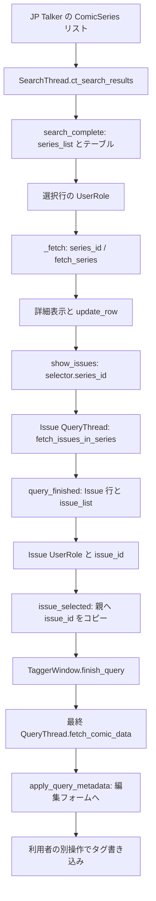

# ComicTagger GUI 列ソート・詳細更新・書誌 ID 整合性の調査

調査日: 2026-10-31（Asia/Tokyo）。状態: **調査・非破壊的実験完了／Production code の修正未着手**。

## 1. Executive Summary

**異なる 3 事象を確認した。セル混在だけから誤書誌取得とは判断しない。**

| 事象 | 今回の結論 |
|---|---|
| 列ソート中の詳細更新 | タイトル・年・巻数列の値で行が移動すると、後続セルを別の行へ書く。通常の選択シグナル経路で再現。ただしこの実験ではタイトルと UserRole、選択 ID、詳細 ID、最終 Fetch ID は一致 |
| キャンセル済み Issue 取得の遅延完了 | 最新 Series 選択 B の Issue 画面へ旧 A の応答が入り、最終取得へ `issue_id=A, series_id=B` が渡る。こちらは取得対象の整合性問題 |
| 空結果・重複検索完了 | 行がなくなっても古い `series_id` と詳細が残る。空結果時は Issues ボタンが無効で、通常 UI からの誤取得は確認していない |

Python 3.14.10／Qt 6.12.0 と Python 3.12.14／Qt 6.11.0 で一致した。主実験は各環境 **93 観測点、84 点で I1〜I3 成立、9 点で I3 違反**。タイトル・年・巻数の変更条件ごとに **3/3 回**セル混在を再現した。Issue 遅延完了は各環境 **3/3 回**、最新 Series と異なる Issue の最終取得を再現した。最小再現コードでも各環境で追加確認した。

**実際の書籍へのタグ書き込みは実行していない。誤った書籍へ保存されたと断定しない。** 実測した最終境界はホストの QueryThread → Talker 呼び出しと、オフラインの実 JP Talker による取得対象選択まで。

推奨は、ホスト側で **A（行更新中のソート停止）と D（検索・Issue 要求の世代管理、キャンセル後の応答棄却、選択状態の同期）を独立した不具合修正として進めること**。行更新の原子性と古い応答の棄却は分離実験で効果を確認した。製品版の実装・採用はまだ行わない。整合性修正の次工程は **GO（条件付き）**、表示順の新機能は **HOLD**。

## 2. Investigation Scope

読み取り専用のソース調査、固定データによる offscreen Qt 実験、本書の作成のみ。前工程の [検索順序調査](ndl-gui-search-order-investigation.md) を再利用し、その文書は変更しない。

- Production code、既存テスト、ホスト本体、既存設定、依存関係、仮想環境に変更なし。
- NDL / MADB への実検索、書誌データ・実書籍への書き込みなし。
- Python コードは PowerShell の標準入力から実行。リポジトリ内に調査スクリプトを保存しない。
- 一時設定・Qt キャッシュは許可された `.tools/pytest-tmp/selection-integrity-*` の固有領域。Git 管理対象外で、実験後に削除。
- commit、push、tag、Release、PR 作成なし。
- 「事実」は指定ソース、「実測」は今回の固定条件、「推論」はコードからの影響評価、「未確認」は未実施の条件として区別する。

Qt の C++ ソース取得や外部ドキュメントの通信は実施していない。Qt 内部アルゴリズムの一般的保証ではなく、実際にロードした Qt バイナリと公開ウィジェット API の観測を根拠とする。

## 3. Environment and Source Revisions

| 項目 | 状態 |
|---|---|
| ブランチ / HEAD | `main` / `d186c8e776a0a7ea6cf70d6da056027cc7fb258d` |
| JP Talker | ソースの `__version__ = "0.4.0"`。今回の 3.14 環境の distribution も 0.4.0 |
| 対応ホスト | [pyproject.toml][JP-project] 13・16 行: `>=1.6.0b9,<1.7`、開発用 `==1.6.0b9` |
| 開始時の Git 状態 | `?? docs/ndl-gui-search-order-investigation.md`。既存の未追跡文書として保護 |
| 主環境 | `.tools/venv-py314-codex/Scripts/python.exe`、Python 3.14.10、pytest 9.2.0、PyQt / Qt 6.12.0 |
| 比較環境 | `.venv/Scripts/python.exe`、Python 3.12.14、PyQt / Qt 6.11.0 |
| 両環境のホスト | `comictagger==1.6.0b9` |
| 固定ソース | `.research/comictagger`、tag `1.6.0-beta.9`、commit `57e5571c91c7515ee2cd594da6c780e61b056b15` |
| ソースの取得元 | 既存 checkout の remote: `https://github.com/comictagger/comictagger.git` |
| インストール元の記録 | 3.12 は上記 checkout を指す `direct_url.json`。3.14 には `direct_url.json` がなく、インストール経路は未特定 |
| 実行方式 | Windows、`QT_QPA_PLATFORM=offscreen`、`PYTHONDONTWRITEBYTECODE=1`、`PYTHONUTF8=1` |

両環境の次の 7 ファイルを checkout とバイト比較し、すべて一致した:
`comictaggerlib/seriesselectionwindow.py`、`issueselectionwindow.py`、`matchselectionwindow.py`、`taggerwindow.py`、`comictalker/comictalker.py`、`comicapi/genericmetadata.py`、`comicapi/comicarchive.py`。

`seriesselectionwindow.py` の SHA-256 は `07be4c64449adc61ba13fee6990941100e90811b5b9896a2faeafe82167ecc4f`。前工程と同一である。古い `.tools/venv-py314` は今回使用していない。

## 4. Previous Findings

前工程の順序維持・無条件の類似度ソート・年設定と候補分類・未使用の完全一致設定・Qt 列状態の残留を引き継ぐ。今回その表示順仕様は変更しない。

今回の差分は、前回の signal 遮断下の `update_row()` 分離実験を、**通常の currentItemChanged → _fetch → update_row 経路**で再検証したこと、および **最終取得と非同期の世代境界**まで追ったことである。

前工程で「通常選択の ID は一致」とした範囲は今回も成立した。新たに確認した古い Issue 応答の混入は、列ソートの行移動とは異なる原因である。

## 5. GUI Selection Data Flow

### 実在する型・メソッド

この版には今回の対象となる `ComicIssue` クラスや `fetch_issues_by_series_id()` はない。[公開 API][H-api] は `fetch_issues_in_series(series_id)` と `fetch_issues_by_series_issue_num_and_year(...)` を使用し、Issue は `GenericMetadata.issue_id / series_id` で表現する。依頼中の仮称を実装済み API として扱わない。

[models.py][JP-models] 38〜39 行の `BookRecord.id`、[sources/ndl.py][JP-ndl] 144〜145 行の ID 設定と 557〜583 行の取得時 ID 照合、[JP Talker][JP-talker] 233〜260、285〜365 行、[mapping.py][JP-map] 469〜537 行により、次の対応になる。

| 段階 | 識別子と取得元 | 次の参照 |
|---|---|---|
| Source ID | `BookRecord.id`、NDL 書誌 URL 由来 | `to_series()` |
| Internal ID | `ComicSeries.id = record.id` | ホストの `series_list[id]` |
| Row ID | 列 0 の `Qt.ItemDataRole.UserRole` | `_fetch(row)` |
| Selected ID | `SeriesSelectionWindow.series_id` | `fetch_series()`、`show_issues()` |
| Detail ID | `_fetch()` が返した ComicSeries の ID | 詳細 HTML、行更新。実験では一意の説明文でも照合 |
| Fetch ID | `fetch_series(series_id)` 等の引数 | JP Talker の `source.get(id)` |
| Issue 選択 ID | `IssueSelectionWindow.issue_id`、行 UserRole 由来 | 親の `issue_selected()` |
| 最終 Fetch ID | `fetch_comic_data(issue_id, series_id, issue_number)` | JP Talker は `issue_id or series_id` を選ぶ |

通常の経路:



主な根拠は [seriesselectionwindow.py][H-series] 63〜80、346〜371、389〜425、517〜549、576〜717 行、[issueselectionwindow.py][H-issues] 39〜71、95〜144、178〜215 行、[taggerwindow.py][H-tagger] 79〜105、1198〜1228 行。

Series 画面の OK は UI 定義上 `accept()` に直結するため、Issue 画面を経由しない経路もある。[seriesselectionwindow.ui][H-series-ui] の connections と 12 節を参照。

## 6. ID Integrity Invariants

行番号は識別子にしない。検証はイベント処理完了後の安定状態で行い、更新途中の状態は別途トレースする。空結果では選択・詳細を空にすることを I5 の期待条件とする。

| 不変条件 | 判定 | 実測と限定 |
|---|---|---|
| I1: 行タイトルと UserRole の一致 | **PASS** | 非空の全試験行で維持。セル混在時もタイトル自体と ID の結合は壊れなかった |
| I2: 選択行と詳細 ID の一致 | **PASS** | 非空の各テーブル内で一致。Series B と旧 Issue A の世代不一致は I4 / I6 で評価する。空結果の古い詳細は I5 |
| I3: ソート後の ID と全表示データの対応 | **FAIL** | 年更新で NDL-C 行に NDL-A の巻数・出版社が混入 |
| I4: 確定候補に属する最終取得対象 | **FAIL** | 最新 Series B に対し旧 Issue A の確定から `fetch_comic_data(A,B,"1")`。通常の列ソート・詳細更新では PASS |
| I5: 更新後の行・詳細・選択の対応 | **FAIL** | 空結果で rowCount=0、current ID=None なのに selected=NDL-A、detail=NDL-A が残る。非空の逐次再検索は PASS |
| I6: 完了順によらない対応 | **FAIL** | キャンセル済み A の Issue 応答が B の応答後に採用される。重複 Series 検索にも途中の空表示を確認 |

I4 は **現在の Issue 行 A と最終 Fetch A の局所的一致が壊れた、という意味ではない**。最新の親 Series B に属する候補として表示・確定されるべき結果へ旧 A が混入した、という処理間の不整合である。Generic なホストでは issue ID と series ID の文字列が違うのは通常であり、その単純な不一致だけを根拠にしない。今回の固定データと JP Talker では 1 書誌の `issue_id == series_id == record.id`、さらに旧応答の `GenericMetadata.series_id=A` と現行要求 B の不一致を確認している。

実書籍への保存結果と、実画像を用いた自動タグ付け全体は **UNVERIFIED**。この調査では実行しない。

## 7. Qt Sorting and Row Mutation Analysis

### セル混在の根拠

[ホスト update_row()][H-series] 346〜371 行は、次の順に同じ整数 `row` を利用する。

1. タイトル列の item を取り、`setText()`、ToolTipRole、UserRole を設定。
2. `item(row,1)` に年。
3. `item(row,2)` に count_of_issues。
4. `item(row,3)` に出版社。

sorting は詳細更新中に無効化されない。ソート対象セルを変えた時点で行が移動すると、後続の `item(row, column)` は別の候補を返す。

**実測:** 年昇順で NDL-A が row=3、NDL-C が row=4 の状態から、A の年を 2020 → 2030 に更新。A の item は row=4 へ移動し、関数のローカル変数 `row` は 3 のまま。巻数・出版社は新しい row=3 の C へ書かれた。

タイトル item は行と一緒に移動し、取得済みの Python item 参照も同じオブジェクトを指す。このためタイトルの `setText()` 後に同じ item へ設定する UserRole は A のままになる。**整数 row は古くなるが、既に取得した item 参照は行移動に追従する**ことが、I1 が保たれつつ I3 が破れる理由である。

### Qt API の観測

| 操作 | 今回の観測 |
|---|---|
| `setSortingEnabled(True)` | 有効なソート列がある場合、その列の順序を適用。再検索時にも再適用 |
| ソート列の `setText()` | `layoutChanged` を伴って行移動。current item 自体は維持 |
| `setData(DisplayRole, "z")` | 2 行の小テーブルで row 0 → 1。setText と同じ表示キーの変更 |
| `setData(UserRole,...)` | 同じテーブルで row は 0 のまま。標準 item の表示ソートキーではない |
| `insertRow(0)` | セル item は未生成で None。挿入だけで完全なレコードにはならない |
| `setSortingEnabled(False)` で全列更新後に復元 | 4 列 × 3 回の分離実験で全セル・選択・最終 ID を保持 |
| 出版社列の変更 | 行移動はするが最後に更新する列なので、今回の update_row では後続セル混在なし |

主実験の変更時は、`currentItemChanged` は選択操作の 1 回、`layoutChanged` は行移動の 1 回、`rowsMoved` は 0 回だった。行が移動したから rowsMoved が必ず出るとは考えない。signal を一時遮断せずに観測した。

`count_of_issues` の表示は今回 `0001` などのゼロ埋めであった。`setData(DisplayRole,int)` を呼んでいるというコードだけから表示文字列の型・見た目を推測せず、実セルを検査した。

初期構築中には空 item・未設定 UserRole が存在するが、`search_complete()` は sorting 無効で構築を完了し、その後に選択する。今回の正常構築で None を Fetch ID に渡す現象はなかった。

## 8. Signal and Event Sequence

### 列見出しクリック

実 QTest マウス操作で Year 列をクリックした観測順:

```text
layoutAboutToBeChanged  current ID=NDL-A
layoutChanged          current ID=NDL-A、item.row()=3
sortIndicatorChanged   column=1、AscendingOrder
```

観測用 slot はホストの既存接続の後に追加した。この記録順を Qt 内部の signal 発生順そのものと混同しない。currentItemChanged はこのクリックでは追加されず、同じ item が選択されたまま移動した。

### 通常選択 → 詳細取得 → 年更新

0 始まりの行番号。実メソッドを `sys.settrace` で観測した。

| 順 | 処理 | ローカル row | currentRow / Row ID | Selected ID / Detail ID |
|---|---|---:|---|---|
| 1 | A を選択、current_item_changed 開始 | 未設定 | 3 / A | B / B（まだ同期前） |
| 2 | _fetch(row) 開始 | 3 | 3 / A | B / B |
| 3 | fetch_series(A) が新詳細を返す | 3 | 3 / A | A / A:v1 |
| 4 | update_row 開始 | 3 | 3 / A | A / A:v1 |
| 5 | 年セルを 2030 に変更、layoutChanged | **3 のまま** | **4 / A** | A / A:v1 |
| 6 | 巻数・出版社を row=3 へ更新 | 3 | 4 / A | A / A:v1 |
| 7 | update_row / current_item_changed 終了 | 3 | 4 / A | A / A:v1 |

5〜6 の間で対象行が変わる。更新に起因する current_item_changed の再入はこの条件では観測しなかった。将来の Talker が内部でイベント ループを回す場合まで保証するものではない。

### キャンセル後の Issue 応答

実 QThread、`threading.Event`、Qt のイベント処理で次の順序を固定した。

```text
A を選択 → show_issues → QueryThread(A) 開始・待機
進捗の Cancel ボタンを押す → wasCanceled=True
Series 画面で B をマウス選択 → show_issues → QueryThread(B) 開始
B を解放 → return(B) → finish(B) → Issue 行 B、selector.series_id=B
A を解放 → return(A) → finish(A) → Issue 行 A、selector.series_id=B
Issue を確定 → 親 series_id=B / issue_id=A
最終 QueryThread → fetch_comic_data(issue_id=A, series_id=B, issue_number="1")
```

キャンセル後の activeModalWidget は Series 画面 `SelectSeries`。B の選択は ID フィールドへの直接代入ではなく QTest の行クリックで行った。Issue 確定は実 `accept()` と connected signal を通した。ワーカーを破棄しないよう実験側で参照を保持した。

[issueselectionwindow.py][H-issues] 95〜116 行は進捗の canceled を要求破棄へ接続していない。結果は `finish(list)` で転送され、要求の ID・世代を `query_finished()` が検査する仕組みがない。source の応答を改変したのではなく、正しい A の応答を誤った現行コンテキストへ適用している。

### Series 検索の完了順・空結果

Series の `search_complete()` は signal の発信元ではなく、その時点の `self.search_thread.ct_search_results` を読む（[同ソース][H-series] 591 行）。制御実験で old / new の `perform_query()` を重複させ old を先に完了させると、未完了の new の空リストを描画した。new 完了後には正しい新結果へ戻った。

これは重複呼び出しを直接行うストレス実験であり、通常の画面操作だけで必ず同じ重複が作れると断定しない。Issue の Cancel → B 選択の実験とは到達条件を区別する。

`update_buttons()` 424〜432 行は空結果で OK も無効化する（コード上の確認）。空結果では `series_list={}`、rowCount=0 になるが、current=None を受けた slot は直ちに return し、古い selected ID と詳細を消さない。Issues ボタンは無効になる。

### 同期・非同期の区別

Series の `_fetch()` → `fetch_series()`、Issue の `_fetch()` → `fetch_comic_data()` は GUI slot 内の同期呼び出し。専用の詳細取得ワーカーはない。一方、検索、Issue 一覧、最終取得、画像照合には別々の QThread がある。

`log_output()`（seriesselectionwindow.py 469〜475 行）は識別進捗画面がある場合に processEvents を呼ぶ。任意の Talker の再入・全イベント順を今回排除したわけではない。今回の通常選択では同期呼び出し中に別候補へ再入する現象は未再現。

## 9. Reproduction Test Design

### データ

| ID | タイトル | 年 | count_of_issues | 説明 / 出版社 |
|---|---|---:|---:|---|
| NDL-A | 検証作品 1 | 2020 | 1 | DETAIL:NDL-A:v0 / PUB:NDL-A |
| NDL-B | 検証作品 2 | 2015 | 2 | DETAIL:NDL-B:v0 / PUB:NDL-B |
| NDL-C | 検証作品 3 | 2025 | 3 | DETAIL:NDL-C:v0 / PUB:NDL-C |
| NDL-D | 検証作品 4 | None | None | DETAIL:NDL-D:v0 / PUB:NDL-D |
| NDL-E | 検証作品 5 | 2015 | 5 | DETAIL:NDL-E:v0 / PUB:NDL-E |

これはホストの境界試験用 ComicSeries。JP Talker の実 `to_series()` は count_of_issues=1 固定であり、2・3・5 を返すと主張しない。実 JP Talker の ID 変換は別の JP_BRIDGE 実験で確認した。架空 ID を実 API へ渡していない。

各操作条件で新しいウィンドウを作り、既存の設定を読まず一時設定を利用した。比較のため年設定・出版社除外を一時的に False とし、既存設定ファイルへは保存していない。

### 実験群とコマンド

両インタープリターについて、調査コードを標準入力で実行した。

```powershell
$env:PYTHONDONTWRITEBYTECODE='1'
$env:PYTHONUTF8='1'
$env:QT_QPA_PLATFORM='offscreen'
@'
<調査用 Python コード>
'@ | .tools/venv-py314-codex/Scripts/python.exe -B -
# 比較時は .venv/Scripts/python.exe -B - を使用
```

一時領域の生成は `TemporaryDirectory(dir=Path(".tools/pytest-tmp").resolve(), prefix="selection-integrity-")`。pytest は実行しておらず、pytest のキャッシュや既存テストを変更していない。

| 実験群 | 各環境の件数・終了コード | 結果 |
|---|---|---|
| 主実験 | 93 観測点、exit 0 | 84 点で I1〜I3 成立、9 点で I3 違反。93 は固有テスト関数数ではなく反復・確定前後を含む観測点 |
| 追加実験 | 19 観測、exit 0 | 行更新ガード 12 成功、旧 Issue 混入 3 再現、header・自動選択引き渡し・JP bridge・Qt roles 各 1 観測 |
| 境界実験 | 6 観測、exit 0 | 空結果の残留 3 再現、重複検索の途中空表示 3 再現。後者は最新応答後に整合 |
| 応答棄却の対照実験 | 3 観測、exit 0 | キャンセル済みワーカーの転送接続を一時解除すると B/B を維持 |
| 本書掲載の最小再現 | 3 観測、exit 0 | 行混在・旧 Issue 混入を各 1 再確認、Series 直接 OK の正常 ID を確認 |

不具合を記録する調査コードなので、不変条件違反を観測してもプロセスの exit 0 はあり得る。これを「全テスト成功」と表現しない。

準備段階では、巻数表示を非ゼロ埋めと仮定した判定と、再検索前の旧 ID を Mock から早く削除した設定を修正した。これらは調査コードの誤りであり製品不具合に数えていない。準備失敗時に残った一時領域 2 個は対象パスを検証して削除した。集計は修正後の実験のみ。

Qt の警告はフォント ディレクトリ未検出と offscreen の `propagateSizeHints()` 非対応。主実験は各 106 件、追加は 34 件、境界は 13 件、応答棄却は 7 件、最小再現は 6 件。成功した実験群の未処理 slot 例外は 0 件。`QTextEditLogger has been deleted` は再現しなかった。フォントやロギングの修正はしていない。

## 10. Reproduction Results

次表は両環境で同じ。P は条件内で成立、F は違反、単純な行位置変更は不具合に数えない。

| ケース | 実施内容 | 結果 |
|---|---|---|
| T01 | 初回表示、先頭選択 | P |
| T02 / T03 | タイトル昇順 / 降順 | P、行と ID を保持 |
| T04 / T05 | 年昇順 / 降順 | P、None を含め ID を保持 |
| T06 | 巻数昇順、追加経路で両方向 | P、1・2・3・5 の順と欠落値を確認 |
| T07 | 出版社降順、追加経路で両方向 | P |
| T08 | 全 4 列 × 両方向の各候補を選択 | P。5 行 × 8 条件 × 3 回の選択を各環境で照合 |
| T09 | 選択時に返る詳細のソートキーを変更 | タイトル・年・巻数は F（I3）。出版社だけは P |
| T10 / T11 | 有効な年列ソートを維持して実 requery、新 ID 集合で再選択 | P、旧候補なし |
| T12 | ソート後、Issue 選択・確定・最終 QueryThread | P。8 ソート条件 × 3 回 |
| T13 | 最初の表示行を selectRow(0) | P。画像照合の Auto-Select とは別 |
| T14 | 年・巻数欠落の NDL-D を選択 | P |
| T15 | 全候補が同題・同年 | P、異なる ID を保持 |
| T16 / T17 | 選択された行のタイトル・年・巻数が変わり移動 | I1 / I2 / 通常の最終 ID は P、I3 は F |
| T18 | 有効な列ソートのまま候補一覧を再構築 | P。列状態は残るが正しい新 ID |
| X01 | Cancel 後、B の後に旧 A の Issue 応答 | F、I4 / I6 |
| X02 | 空結果 | F、I5。古い詳細・選択スカラーが残るが Issues 無効 |
| X03 | old / new の Series 検索を重複起動 | 途中は F、最新完了後 P。通常 UI の到達性は未確認 |
| X04 | update_match の結果 ID から Issue へ | P。画像照合本体は実行しない |
| X05 | Series 画面の直接 OK | P、空 issue_id と選択 series_id を渡す |

### セル混在の具体値

年変更時、期待する NDL-C 行は `["検証作品 3","2025","0003","PUB:NDL-C"]`。実測は `["検証作品 3","2025","0001","PUB:NDL-A"]`、UserRole は **NDL-C のまま**。

タイトル変更では NDL-B 行へ A の年・巻数・出版社、巻数変更では NDL-B 行へ A の出版社が入った。出版社は最後の更新列のため、その変更だけでは後続セルの誤更新はなかった。

### 再現率の意味

タイトル・年・巻数は各環境で各 3/3、計 **18/18** の主実験で再現。旧 Issue 混入は **6/6**。これらは制御した固定条件の再現率であり、実利用時の発生頻度ではない。本書の最小再現による追加確認はこの分母に重複算入しない。

## 11. Selection and Detail Consistency

- **行データの混在:** Row ID C に A の出版社が付くが、タイトル C と UserRole C は一致する。
- **選択・詳細:** A の行移動後も current item は A、`series_id=A`、説明文も A。行番号だけが変化する。
- **内部辞書:** `_fetch()` は取得した詳細を `series_list` へ書き戻さない。検索時の ComicSeries と詳細時の ComicSeries が異なる版として存在し得る。これは単独では別 ID の混入を意味しない。
- **空結果:** 有効な選択行がなくても旧詳細が残る。操作を無効化するだけでは表示状態の整合までは満たさない。
- **Issue の世代不一致:** Issue 行 A・詳細 A・UserRole A は局所的に一致していても、タイトルバーと要求コンテキストは B。この不一致を I2 の単純な行照合だけでは検出できない。

CATEGORY C に相当する「非空の現在行 B を選んだのに、Series の selected ID が A」という現象は今回再現していない。CATEGORY D の問題は、古い子結果を現在の親へ結び付けたことによる。

## 12. Final Fetch ID Verification

### 通常経路

`show_issues()` → 実 Issue QueryThread → `query_finished()` → Issue `accept()` → 親 `issue_selected()` → 最終 QueryThread.run() の順で、取得 Mock の引数を記録した。

セル混在後の A 選択も最終引数は `("NDL-A","NDL-A","1")`。全列ソート後の E 確定は E/E。Series 直接 OK は `issue_id="", series_id="NDL-B", issue_number=""`。これらは一致した。

ホストの `finish_query()`（[taggerwindow.py][H-tagger] 1202〜1214 行）は selector の 3 値を QueryThread へコピーする。実験はその同じ 3 値で実 QueryThread を構成して run した。メインの TaggerWindow 全体の編集フォーム・保存処理は実行していない。

### 旧 Issue 混入後

最新 Series B、Issue 画面タイトル `検証作品 2 (2015) - Select Issue`、その中に旧 Issue A と説明 `ISSUE-DETAIL:NDL-A`。確定後の実ホスト QueryThread は:

```python
fetch_comic_data(issue_id="NDL-A", series_id="NDL-B", issue_number="1")
```

別の **実 JP Talker** で source だけをオフライン Mock に置き換えて同じ引数を渡すと、[talker.py][JP-talker] 314 行の `selected = issue_id or series_id` により `source.get("NDL-A")` を呼び、返却 metadata の issue_id / series_id はともに A になった。これは正しい Issue ID 優先の既存契約であり、JP Talker が B を選び直して回避すべきではない。

### 書き込みまでの静的追跡

[TaggerWindow][H-tagger] の QueryThread.finish → `query_finished` → `apply_query_metadata()`（335、1216〜1228 行）で `prepare_metadata()` を通して編集フォームへ反映。その後、利用者の別の保存操作で `prompt_write_tags()` → `write_tags()`（1268〜1292 行）→ [ComicArchive.write_tags()][H-archive]（236〜244 行）→ タグ writer へ渡る。この最後の経路はコード解析のみ。

画像照合の Auto-Select は `IdentifyThread` → `identify_complete()` → `update_match(IssueResult)` → `select_by_id()` → `show_issues()`。IssueResult B の引き渡しは実測一致したが、実画像の照合は未実施。

一括自動タグ付けは [AutoTagThread][H-autotag] 173〜210 行から `identify_comic()`、結果 metadata、`ca.write_tags()` へ進み、この候補テーブルの行更新を通らない。今回の row 混在・Issue ダイアログ応答競合が一括処理にも発生するとする根拠はない。GUI Auto-Select は Issue ダイアログを共有するため世代管理の回帰対象には含める。

## 13. Root Cause and Impact Classification

| 分類 | 判定と根拠 |
|---|---|
| CATEGORY A: 表示のみ | 空結果に旧詳細が残る。旧 Issue 混入では B のタイトルバーに A の内容が出る |
| CATEGORY B: テーブル内部 | row の整数値を使い続けることで、C の UserRole と A の巻数・出版社が同居 |
| CATEGORY C: 選択 ID | 非空の行と selected ID の食い違いは未再現。空結果には古い selected スカラーが残るが、確定 UI は無効 |
| CATEGORY D: 取得対象 | 最新 Series B の処理に旧 Issue A が採用され、最終取得が A/B、実 JP Talker の source.get は A |
| CATEGORY E: 未確認 | 実書籍への誤保存、全 Talker の再入、実画像照合、一括自動タグ付けの競合、他 Qt 版 |

根本原因は 3 つ。

1. **ホストによる Qt の使い方:** 複数セル更新を原子的に扱わず、ソートで無効になった row を再利用。
2. **ホストの非同期連携:** Issue の結果・キャンセルに要求世代の照合がない。Series 検索も mutable な現在の thread を参照。
3. **状態のクリア不足:** 無選択・空結果時に selected ID と詳細を破棄しない。

NDL の取得順保持や JP Talker の日付解決がこれらを発生させる処理ではない。ただし検索時と詳細時の値が変われば行更新問題の発火条件にはなる。実際の NDL 応答でどの頻度で値が変わるかは未調査。

## 14. Remediation Options A–D

本書の A〜D は今回の「整合性修正方式」。前工程の「表示順実現方式 A〜D」とは別である。

| 方式 | 効果・実証 | 変更規模 / 互換性 | 限界・評価 |
|---|---|---|---|
| A: 行更新中のソート停止 | 実 update_row の前後だけ sorting を止めて復元する一時ラッパーで 4 列 × 3 回 × 2 環境、**24/24 成立** | 小。既存列・方向を維持可能 | 行混在には有効。古い応答・空詳細は解決しない。**最小候補として推奨** |
| B: ID / item 基準の更新 | 既存 UserRole と移動に追従する item 参照を利用可能 | 小〜中。毎セルの再探索なら重複 ID・途中欠損に注意 | row を ID から 1 回求めるだけでは再び古くなる。全 item を先に保持する等が必要。独立案の効果未実証、**CONDITIONAL** |
| C: QTableView / モデル・プロキシ | レコードと行位置を分離できる設計候補 | 大。Series・Issue・共有 SelectionWindow の変更と広い回帰確認 | 今回未実装・未実証。upstream 採否不明。緊急の最小修正には不向き、**HOLD** |
| D: 選択・詳細・要求世代の同期 | 旧ワーカーの result 転送を一時切断する対照実験で **6/6 B/B を維持** | 中。キャンセル・再検索・同一 ID の再要求を一貫して扱う必要 | 単なる再選択・signal 抑制だけでは row 混在を直せない。汎用世代トークンは設計段階。**非同期修正候補として推奨** |

A の一時ラッパー、D の転送接続解除は実験用インスタンスだけに適用し、各プロセス終了で破棄した。製品へ monkey patch を導入したものではない。対照実験で解消した範囲を超え、例外時・同じ Series の再要求・ダイアログ破棄などまで修正効果を保証していない。

## 15. Compatibility and Regression Risks

- JP Talker 単独での修正は **NO-GO**。GUI の row・signal・要求世代を公開 Talker API から制御できない。
- ホスト修正が必要。公開 Talker API の拡張は不要。内部ワーカーの signal payload / slot は変更候補。
- 他 Talker にも同じホスト経路がある。issue ID と series ID が別のソースを含めて検証し、文字列一致をホスト一般の不変条件にしない。
- ソート列・方向・選択 ID は更新前後で維持する。類似度、年設定、NDL の取得順を変更しない。
- ISBN ランキング、itemno、キャッシュキー、日付、資料種別、タグ書き込みは対象外。
- GUI Auto-Select は共有 Issue 経路の回帰対象。一括自動タグ付けの照合・保存順を変更しない。
- blockSignals を用いる場合、table の選択通知と model の行変更通知を混同しない。model の通知を止めて内部インデックスを壊してはならない。
- キャンセルは HTTP を強制終了することと同義にしない。結果の適用を無効化し、ワーカー終了まで参照を安全に保持する。
- ソートを止めることだけで要求世代の不整合が直ったと判断しない。

## 16. Recommended Remediation

**独立したホスト不具合修正を先行させる。**

優先順位は、取得対象を変え得る Issue の世代管理、行更新の原子性、空状態の同期の順とする。小さな別コミット・別回帰テストに分け、前工程の Source order 機能へ混在させない。

A の最小形は実証済みだが、通常終了だけの一時ラッパーをそのまま製品にコピーしない。対象 ID・選択 item を保持し、例外でも sorting の状態を復元する仕様にする。D は「キャンセル済み応答を採用しない」効果を確認した段階であり、製品では切断だけに依存せず要求トークンで検証する。

これにより、実証済みの原因へ対応しつつ、全体のモデル・ビュー置換を先に要求しない。

## 17. Proposed Implementation Specification

以下は次工程の仕様であり、今回のソース変更ではない。

### A. 行更新の原子性

対象: `seriesselectionwindow.py` の `SeriesSelectionWindow.update_row()`、`current_item_changed()`。共有基底・Issue 側にも同様の更新があるため、`SelectionWindow.current_item_changed()`、`IssueSelectionWindow.update_row()` を回帰対象にする。

1. 対象の UserRole ID と current item を取得し、要求した詳細の ID と照合する。
2. `isSortingEnabled()`、ソート列・方向を保存する。
3. sorting を無効化し、同じ候補の全セルを更新する。ID を書き換えて別書誌として流用しない。
4. `finally` で元の sorting 状態を復元する。元が False なら True にしない。
5. 必要なら ID / item 参照で選択を復元する。無条件に先頭行を選ばない。
6. 余計な詳細再取得・再入を防ぐガードを設ける場合は、終了時に現在 ID と詳細 ID を再照合する。
7. 例外・欠損 item・候補消失時は更新を中断し、別の row に書き続けない。

`series_list` へ詳細を反映するかは別の仕様判断。必要なら同一 ID だけを更新し、検索時の source rank を変更しない。

### B. Issue 要求の世代・確定境界

対象: `issueselectionwindow.py` の `QueryThread`、`perform_query()`、`query_finished()`、Cancel 接続、および `seriesselectionwindow.py` の `show_issues()` / `issue_selected()`。

1. 要求ごとに単調増加する token と requested_series_id を発行し、ワーカーに不変値として渡す。
2. 完了は token・requested_series_id・結果（またはエラー）を GUI スレッドの slot へ渡す。結果内の値だけから発信要求を推定しない。
3. 現在の token と ID に合致する場合だけ描画する。同じ Series の新旧要求も token で区別する。
4. Cancel・新規要求・画面終了で古い token を無効化。キャンセル済み完了を受けても表示・選択・progress を変更しない。
5. ワーカー参照を終了まで保持し、古い worker が新しい progress を閉じることも防止する。
6. 再取得開始時に `initial_id`、`issue_id`、古い issue_list と詳細を適切にクリアし、検証済み結果が来るまで確定を無効化する。
7. 確定時には、選択 Issue が現在採用した token の結果集合に属し、親の現在 Series と同じ要求に属することを確認する。
8. issue_id と series_id の文字列一致を強制しない。汎用ホストでは結果の `GenericMetadata.series_id` と requested ID の関係、および要求の帰属を使う。
9. 無効状態では取得へ進めない。JP Talker 側で issue_id を無視して series_id を選ぶ回避策は採らない。

### C. Series 検索と空状態

対象: `SearchThread`、`perform_query()`、`search_complete()`、`search_canceled()`、共通の選択更新。

- 現在の mutable thread から結果を読む方式を、完了要求自身の token と payload を照合する方式へ変える。
- 古い完了は採用せず、最新要求の進捗を閉じない。
- 空結果、フィルターですべて消えた場合、選択候補消失時には selected ID・詳細・リンク・Issue の旧選択状態をクリアする。
- 新結果での初期選択は構築完了後に実行し、その ID の詳細を同期する。
- 範囲の広い UI 再構成は不要。既存の見た目・検索順設定を維持する。

### D. 実装工程

| 工程 | 作業・完了条件 |
|---|---|
| I0 | 本書の再現と原因分析。完了 |
| I1 | A と D の最小ホスト修正設計をレビュー。token payload、キャンセル、破棄、同一 Series 再要求、例外時復元の仕様を確定 |
| I2 | 独立した修正実装。まず Issue 世代境界、次に行更新・空状態。実装ファイルと公開 API の差分を限定 |
| I3 | 下記の固定データ回帰テストをホストに追加。修正前に失敗し、修正後に成立することを確認 |
| I4 | Python 3.12 / 3.14、Qt 6.11 / 6.12、通常表示・offscreen、複数 Talker で GUI 統合検証 |
| I5 | 対応版・根拠・独立再現を添えて upstream へ報告・提案。別途承認された工程で実施 |

## 18. Regression Test Plan

既存ホストの `tests` で `SeriesSelectionWindow` / `IssueSelectionWindow` の参照を検索したが、今回の経路を直接扱う GUI テストは見つからなかった。今回、既存テストは追加・変更していない。

各入力は 9 節の A〜E。表にないデータ変形は明記する。実装と同じソートを期待値生成に使わず、期待 ID・セル値・Fetch 引数を固定する。

| テスト名 | 事前条件 / 入力 | 操作 | 期待結果 | 不変条件 / 失敗モード |
|---|---|---|---|---|
| `initial_selection_identity` | 新規ウィンドウ A〜E | 初回表示 | 行 ID とタイトル、初期詳細一致 | I1・I2、構築途中の None fetch |
| `column_sort_preserves_identity` | 各列・昇降順を独立設定 | 全候補を選択 | UserRole・詳細・Fetch ID が一致 | I1〜I4、位置を ID に誤用 |
| `detail_title_mutation_atomic` | タイトル昇順、A の新題は `龥 changed A` | B → A 選択 | B に A の年等が入らない | I3、タイトル更新直後の行移動 |
| `detail_year_mutation_atomic` | 年昇順、A は 2030 | B → A 選択 | C は 2025 / 3 / PUB:C のまま | I3、固定 row の後続利用 |
| `detail_count_mutation_atomic` | 巻数昇順、A は 20 | B → A 選択 | B の出版社を保持 | I3、DisplayRole による移動 |
| `detail_publisher_mutation` | 出版社昇順、A は ZZZ | B → A 選択 | 全セル一致、選択維持 | I1〜I3、対照ケース |
| `restore_sort_on_update_error` | 各 sorting 状態 | 途中で制御例外 | 元の状態を復元、他行を更新しない | I3、finally 不足 |
| `missing_and_equal_values` | D、全同題・同年 | 両方向ソート・選択 | 各 ID を維持 | I1〜I4、欠落・同値の混同 |
| `refresh_rebuild_identity` | 年列ソート済み | ID を -NEW にした結果へ再検索 | 旧 ID なし、詳細一致 | I5、残留データ |
| `empty_refresh_clears_selection` | A 選択済み | 空結果 | ID・詳細・リンクを空にし確定無効 | I5、空画面に旧詳細 |
| `cancelled_issue_result_ignored` | A 取得を Event で保留 | Cancel → B 取得 → B 完了 → A 完了 | B の結果のみ維持、最終 B/B | I4・I6、旧応答の採用 |
| `same_series_new_generation` | 同じ Series の旧・新 payload | 完了を逆転 | 最新 token だけ採用 | I6、ID 比較だけの不十分な修正 |
| `old_search_completion_ignored` | old / new SearchThread | old を先に完了 | new の未完了リストで空表示しない | I5・I6、現在 thread の取り違え |
| `issue_initial_id_reset` | 前の Issue 選択が存在 | 新結果で対応番号なし | 旧 initial_id を使わない | I4・I5、選択スカラー残留 |
| `close_pending_dialog` | worker 未完了 | Cancel / 閉じる後に完了 | 閉じた UI を更新せず worker 安全解放 | I6、QObject 寿命・再描画 |
| `accept_current_generation_only` | 古い結果・保留中 | OK / ダブルクリック | 無効状態は取得に進まない | I4・I6、確定時の競合 |
| `final_fetch_arguments` | Issue 経由と Series 直接 OK | 実 QueryThread へ接続 | 正しい issue / series / number | I4、親子 ID の不一致 |
| `jp_id_bridge` | 実 JP Talker、source Mock | 検索・Series・Issue・最終取得 | record.id を維持、既存 issue_id 優先 | I4、ホスト対策をプラグインへ誤実装 |
| `auto_match_dispatch` | 固定 IssueResult B | update_match → Issue | B の結果へ移行 | I4・I6、ID からの再選択漏れ |
| `distinct_issue_series_ids` | 他 Talker、issue X は series B 所属 | 正常・古い応答を比較 | 正常な X/B は許可、旧世代だけ拒否 | I4・I6、誤った文字列同一性制約 |

シグナル観測には QSignalSpy とイベント トレースを使用する。currentItemChanged の回数だけで判断せず、layoutChanged・current item の同一性・全セル・要求 token を検査する。実書籍へは書かず、最終取得と writer の入口は Mock または静的解析で止める。

## 19. GO / HOLD / NO-GO Decision

| 判断条件 | 判定 | 根拠 |
|---|---|---|
| 再現できたか | GO | セル混在 18/18、旧 Issue 混入 6/6（制御条件） |
| 原因を特定できたか | GO | row の有効期間と要求世代の欠落を別々に特定 |
| 表示だけか | GO（判別済み） | 行混在は B、Issue 世代競合は D。非空行の C は未再現 |
| 取得対象への影響 | GO（確認済み） | 最終 A/B と実 JP source.get(A) |
| イベント順 | GO（対象条件） | 通常 slot、layout、Cancel、実 QThread 完了順を観測。任意再入は未確認 |
| 最小修正 | GO（次工程） | A の原子性、D の古い応答棄却を対照実験で確認 |
| 全体の修正安定性 | HOLD | 例外・同一 Series 再要求・画面破棄・全ホスト経路の正式回帰は必要 |
| 他 Talker 互換 | HOLD | 公開 API は維持可能だが、異なる issue / series ID の統合試験が必要 |
| 固定回帰テストの見込み | GO | 実ワーカー、Event、offscreen Qt、明示期待値で再現可能 |
| upstream 提案 | GO（提案準備） | 版・固定リビジョン・再現コード・影響境界を提示可能。送信は今回しない |
| JP Talker 単独の回避 | NO-GO | GUI の内部状態へ依存しない公開手段なし |
| 表示順新機能より先行するか | GO（先行） | 実際の取得引数へ影響する独立不具合を先に扱う |
| Source order 新機能の開始 | HOLD | 整合性修正の受入後に前工程の判断へ戻る |

ここでの GO は技術調査に基づく次工程の判断であり、今回の実装修正・公開の実施を意味しない。今回の成果物は本書のみ。

## 20. Open Questions and Next Actions

1. 汎用の要求 token をどの内部 signal / slot に載せるかを I1 で確定し、同一 Series の新旧要求でも成立させる。
2. 例外・Cancel・ウィンドウ破棄時の worker 所有権と progress の寿命を検証する。実験では worker を明示保持した。
3. Series 検索の重複起動はプログラムによるストレス条件。通常 GUI からの経路・実際の modal 制約を追加確認する。
4. 行更新中にイベント ループへ再入する Talker、長時間のレート制限 callback、Auto-Select 併用を検証する。
5. IssueSelectionWindow 自身の row 更新にも同種の設計がある。複数 Issue の番号・日付・タイトルが詳細で変わる固定例を追加する。
6. 一括自動タグ付けへ今回の不具合が伝播すると断定しない。GUI の修正がその既存契約へ影響しないことを正式回帰で確認する。
7. Python・Qt の 2 組を今回比較できたが、利用者の実ウィンドウ、他 OS、後続ホスト版は未確認。対象版を固定して受入を行う。
8. 実データでの発生頻度や書籍への誤保存は今回確認していない。今回の修正判断に実書籍への書き込み実験は不要。
9. 前工程の文書は履歴として保持し、次工程の表示順実装へ進む前に本書の整合性条件を参照する。

### 最小再現コード

次のコードは本書の主な 2 現象と Series 直接 OK を、通常の GUI slot / 実 QThread で再現する。9 節の標準入力コマンドで実行する。調査用の Mock、単純な待機、ワーカー保持は検証のためであり、製品実装案ではない。

<details>
<summary>両環境で実行した最小再現コード</summary>

```python
import copy,gc,hashlib,importlib.metadata as md,json,logging,os,re,sqlite3,sys,tempfile,time,threading
from dataclasses import replace
from pathlib import Path
from types import SimpleNamespace
from unittest.mock import Mock,patch
import requests
from PyQt6 import QtCore,QtWidgets,QtTest
from comicapi.genericmetadata import ComicSeries,GenericMetadata
from comictaggerlib.ctsettings import ComicTaggerPaths
from comictaggerlib.main import App
from comictaggerlib.seriesselectionwindow import SearchThread,SeriesSelectionWindow
from comictaggerlib.taggerwindow import QueryThread as FinalThread
from comictaggerlib.resulttypes import IssueResult
from comictagger_jp_talker.talker import JapaneseBooksTalker
logging.disable(logging.CRITICAL)
app=QtWidgets.QApplication.instance() or QtWidgets.QApplication([])
qt_warnings=[]
QtCore.qInstallMessageHandler(lambda kind,ctx,msg:qt_warnings.append(msg))
slot_errors=[]
def exception_hook(typ,exc,tb):
    import traceback
    slot_errors.append((typ.__name__,str(exc)))
    traceback.print_exception(typ,exc,tb)
sys.excepthook=exception_hook
ROLE=QtCore.Qt.ItemDataRole.UserRole
ASC=QtCore.Qt.SortOrder.AscendingOrder
DESC=QtCore.Qt.SortOrder.DescendingOrder
spec=[("NDL-A","検証作品 1",2020,1),("NDL-B","検証作品 2",2015,2),("NDL-C","検証作品 3",2025,3),("NDL-D","検証作品 4",None,None),("NDL-E","検証作品 5",2015,5)]
def base_data():
    return [ComicSeries(id=i,name=n,aliases=set(),count_of_issues=c,count_of_volumes=None,description="DETAIL:"+i+":v0",image_url="",publisher="PUB:"+i,start_year=y,format=None) for i,n,y,c in spec]
def itemid(item):
    return item.data(ROLE) if item is not None else None
def snap(w):
    t=w.twList
    return dict(rows=[dict(id=itemid(t.item(r,0)),cells=[t.item(r,c).text() if t.item(r,c) else None for c in range(4)]) for r in range(t.rowCount())],current_row=t.currentRow(),current_id=itemid(t.item(t.currentRow(),0)),selected=w.series_id,detail=w.teDescription.toPlainText())
def fields(r):
    return [r.name,f"{r.start_year:04}" if r.start_year is not None else "",f"{r.count_of_issues:04}" if r.count_of_issues is not None else "",r.publisher]
def evaluate(w,expected):
    s=snap(w)
    return dict(I1=all(row["id"] in expected and row["cells"][0]==expected[row["id"]].name for row in s["rows"]),I2=("DETAIL:"+str(s["current_id"])+":") in s["detail"] and s["selected"]==s["current_id"],I3=all(row["id"] in expected and row["cells"]==fields(expected[row["id"]]) for row in s["rows"]))
def waitfor(pred,timeout=5):
    end=time.monotonic()+timeout
    while not pred():
        app.processEvents()
        if time.monotonic()>end:raise AssertionError("event timeout")
        QtTest.QTest.qWait(1)
    app.processEvents()
def forbid(*a,**kw):raise AssertionError("NETWORK FORBIDDEN")
runs=[]; traces={}
workspace_temp=Path(".tools/pytest-tmp").resolve()
workspace_temp.mkdir(exist_ok=True,parents=True)
with tempfile.TemporaryDirectory(prefix="selection-integrity-",dir=workspace_temp) as tmp,patch.object(requests.sessions.Session,"request",forbid):
    root=Path(tmp).resolve(); assert root.parent==workspace_temp
    host=App();host.talkers={};paths=ComicTaggerPaths(root/"config")
    host.initialize_dirs(paths);host.register_settings(False)
    config=host.parse_settings(paths,"--config",str(paths.path))[0]
    config.Auto_Tag__use_publisher_filter=False
    config.Issue_Identifier__sort_series_by_year=False
    config.Issue_Identifier__exact_series_matches_first=False
    parent=QtWidgets.QWidget()
    windows=[]; talkers=[]
    def create():
        data=base_data(); expected={s.id:copy.deepcopy(s) for s in data}; historical=copy.deepcopy(expected)
        talker=JapaneseBooksTalker("1.6.0b9",root/"talker")
        calls=[]
        def fetch(rid,**kw):
            calls.append(("fetch_series",rid,threading.get_ident()))
            return copy.deepcopy(expected[rid] if rid in expected else historical[rid])
        def issues(rid,**kw):
            calls.append(("fetch_issues_in_series",rid,threading.get_ident()))
            return [GenericMetadata(issue_id=rid,series_id=rid,issue="1",title="ISSUE:"+rid,description="ISSUE-DETAIL:"+rid,year=2020,month=1)]
        def comic(issue_id=None,series_id=None,issue_number="",**kw):
            rid=issue_id or series_id
            calls.append(("fetch_comic_data",issue_id,series_id,issue_number,threading.get_ident()))
            return GenericMetadata(issue_id=rid,series_id=rid,issue="1",title="ISSUE:"+rid,description="ISSUE-DETAIL:"+rid,year=2020,month=1)
        talker.search_for_series=Mock(side_effect=lambda *a,**k:copy.deepcopy(data))
        talker.fetch_series=Mock(side_effect=fetch)
        talker.fetch_issues_in_series=Mock(side_effect=issues)
        talker.fetch_comic_data=Mock(side_effect=comic)
        w=SeriesSelectionWindow(parent,config,talker,series_name="検証作品")
        th=SearchThread(talker,"検証作品",False);th.run();w.search_thread=th;w.search_complete();app.processEvents()
        windows.append(w);talkers.append(talker)
        return w,talker,data,expected,calls
    def choose(w,rid):
        row=next(i for i,x in enumerate(snap(w)["rows"]) if x["id"]==rid)
        w.twList.selectRow(row);app.processEvents()
    def complete(w,talker,calls):
        w.show_issues()
        thread=w.selector.querythread
        waitfor(lambda:thread.isFinished() and w.selector.twList.rowCount()>0)
        w.selector.accept()
        app.processEvents()
        final=FinalThread(talker,w.issue_id,w.series_id,w.issue_number)
        final.run()
        return dict(parent_series=w.series_id,parent_issue=w.issue_id,selector_series=w.selector.series_id,selector_issue=w.selector.issue_id,last_fetch=calls[-1][:4])
    def record(name,w,expected,**extra):
        runs.append(dict(test=name,result=evaluate(w,expected),snapshot=snap(w),**extra))

    w,t,data,expected,calls=create()
    w.twList.sortItems(1,ASC);choose(w,"NDL-B")
    expected["NDL-A"]=replace(expected["NDL-A"],start_year=2030,description="DETAIL:NDL-A:v1")
    choose(w,"NDL-A")
    print("ROW_MUTATION",json.dumps(dict(result=evaluate(w,expected),state=snap(w),final=complete(w,t,calls)),ensure_ascii=False))
    w.hide()
    extra=[]
    # Actual QThreads: cancel older Issue query; newer query completes before older.
    held=[]
    for rep in range(1):
        w,t,data,expected,calls=create();choose(w,"NDL-A")
        gates={i:threading.Event() for i in ("NDL-A","NDL-B")}
        started={i:threading.Event() for i in gates}
        normal=t.fetch_issues_in_series.side_effect
        events=[]
        def delayed(rid,**kw):
            events.append(("start",rid))
            started[rid].set()
            assert gates[rid].wait(5)
            events.append(("return",rid))
            return normal(rid,**kw)
        t.fetch_issues_in_series.side_effect=delayed
        w.selector.finish.connect(lambda result:events.append(("finish",result[0].series_id)))
        w.show_issues();older=w.selector.querythread;held.append(older)
        waitfor(lambda:started["NDL-A"].is_set())
        buttons=w.selector.prog_dialog.findChildren(QtWidgets.QPushButton)
        next(b for b in buttons if "Cancel" in b.text()).click()
        app.processEvents()
        canceled=w.selector.prog_dialog.wasCanceled()
        # Real selection event, not a change to the selected-ID field.
        row=next(i for i,r in enumerate(snap(w)["rows"]) if r["id"]=="NDL-B")
        w.twList.scrollToItem(w.twList.item(row,0))
        QtTest.QTest.mouseClick(w.twList.viewport(),QtCore.Qt.MouseButton.LeftButton,pos=w.twList.visualItemRect(w.twList.item(row,0)).center())
        app.processEvents();assert w.series_id=="NDL-B",snap(w)
        modal=app.activeModalWidget()
        w.show_issues();newer=w.selector.querythread;held.append(newer)
        waitfor(lambda:started["NDL-B"].is_set())
        gates["NDL-B"].set()
        waitfor(lambda:newer.isFinished() and w.selector.issue_id=="NDL-B")
        afternew=dict(series=w.series_id,issue=w.selector.issue_id,selector_series=w.selector.series_id)
        gates["NDL-A"].set()
        waitfor(lambda:older.isFinished() and w.selector.issue_id=="NDL-A")
        afterold=dict(series=w.series_id,issue=w.selector.issue_id,selector_series=w.selector.series_id,title=w.selector.windowTitle(),detail=w.selector.teDescription.toPlainText())
        w.selector.accept();app.processEvents()
        final=FinalThread(t,w.issue_id,w.series_id,w.issue_number);final.run()
        extra.append(dict(name="STALE_ISSUE",rep=rep,canceled=canceled,active_modal_after_cancel=modal.objectName() if modal else None,events=events,afternew=afternew,afterold=afterold,final_fetch=calls[-1][:4]))
        w.hide()

    print("STALE_RESULT",json.dumps(extra,ensure_ascii=False))
    w,t,data,expected,calls=create();w.twList.sortItems(0,DESC);choose(w,"NDL-B")
    w.buttonBox.button(QtWidgets.QDialogButtonBox.StandardButton.Ok).click();app.processEvents()
    assert w.result()==QtWidgets.QDialog.DialogCode.Accepted
    final=FinalThread(t,w.issue_id,w.series_id,w.issue_number);final.run()
    assert calls[-1][1:3]==("","NDL-B")
    print("DIRECT_SERIES_OK",json.dumps(calls[-1][:4]))
    for w in windows:
        for th in (w.search_thread,getattr(w.selector,"querythread",None)):
            if th:th.wait(5000)
        w.selector.hide();w.hide();w.deleteLater()
    parent.deleteLater();app.sendPostedEvents(None,QtCore.QEvent.Type.DeferredDelete);gc.collect()
    for obj in gc.get_objects():
        if isinstance(obj,sqlite3.Connection):
            try:
                files=[Path(row[2]).resolve() for row in obj.execute("PRAGMA database_list") if row[2]]
                if files and all(p.is_relative_to(root) for p in files):obj.close()
            except sqlite3.ProgrammingError:pass
print("CLEANUP",not root.exists(),"QT_WARNINGS",len(qt_warnings),"LOGGER_DELETED",any("QTextEditLogger" in str(x) for x in slot_errors+qt_warnings))
```

</details>

### 完了時の検証

- 開始前に採取した追跡対象ファイルと前工程文書の SHA-256 計 132 件を照合し、変更 0 件。
- ホスト checkout は `git status --short` が空。両環境の対象 7 ファイルも固定ソースと引き続き一致。
- `git diff --check` と、新規文書を対象にした `git diff --no-index --check -- NUL docs/ndl-gui-selection-integrity-investigation.md` を実行し、空白エラーなし。
- 新規文書の UTF-8、末尾空白、改行、Python コード ブロックの構文、参照定義と固定リビジョン内の対象パス・行の存在を検査。
- ソース URL はローカルの固定 checkout と照合。外部 HTTP によるリンク到達確認はしていない。
- `git check-ignore .tools/pytest-tmp` で管理対象外を確認。今回の `selection-integrity-*` 一時領域の残留なし。
- Production code、既存テスト、前工程文書は未変更。全テスト スイートは再実行していない。
- 今回追加したファイルは本書だけ。ステージ操作なし。終了時の状態は次のとおり。

```text
?? docs/ndl-gui-search-order-investigation.md
?? docs/ndl-gui-selection-integrity-investigation.md
```

### 固定ソース参照

以下のホスト参照はすべて `57e5571c91c7515ee2cd594da6c780e61b056b15`、JP Talker 参照はすべて `d186c8e776a0a7ea6cf70d6da056027cc7fb258d`。本文の行番号はこの固定ソースに対応する。

[JP-project]: https://github.com/karigane-cha/comictagger-jp-talker/blob/d186c8e776a0a7ea6cf70d6da056027cc7fb258d/pyproject.toml#L13
[JP-talker]: https://github.com/karigane-cha/comictagger-jp-talker/blob/d186c8e776a0a7ea6cf70d6da056027cc7fb258d/comictagger_jp_talker/talker.py#L233
[JP-map]: https://github.com/karigane-cha/comictagger-jp-talker/blob/d186c8e776a0a7ea6cf70d6da056027cc7fb258d/comictagger_jp_talker/mapping.py#L469
[JP-models]: https://github.com/karigane-cha/comictagger-jp-talker/blob/d186c8e776a0a7ea6cf70d6da056027cc7fb258d/comictagger_jp_talker/models.py#L38
[JP-ndl]: https://github.com/karigane-cha/comictagger-jp-talker/blob/d186c8e776a0a7ea6cf70d6da056027cc7fb258d/comictagger_jp_talker/sources/ndl.py#L144
[H-api]: https://github.com/comictagger/comictagger/blob/57e5571c91c7515ee2cd594da6c780e61b056b15/comictalker/comictalker.py#L172
[H-series]: https://github.com/comictagger/comictagger/blob/57e5571c91c7515ee2cd594da6c780e61b056b15/comictaggerlib/seriesselectionwindow.py#L346
[H-issues]: https://github.com/comictagger/comictagger/blob/57e5571c91c7515ee2cd594da6c780e61b056b15/comictaggerlib/issueselectionwindow.py#L39
[H-tagger]: https://github.com/comictagger/comictagger/blob/57e5571c91c7515ee2cd594da6c780e61b056b15/comictaggerlib/taggerwindow.py#L79
[H-series-ui]: https://github.com/comictagger/comictagger/blob/57e5571c91c7515ee2cd594da6c780e61b056b15/comictaggerlib/ui/seriesselectionwindow.ui#L279
[H-archive]: https://github.com/comictagger/comictagger/blob/57e5571c91c7515ee2cd594da6c780e61b056b15/comicapi/comicarchive.py#L236
[H-autotag]: https://github.com/comictagger/comictagger/blob/57e5571c91c7515ee2cd594da6c780e61b056b15/comictaggerlib/autotagprogresswindow.py#L173
